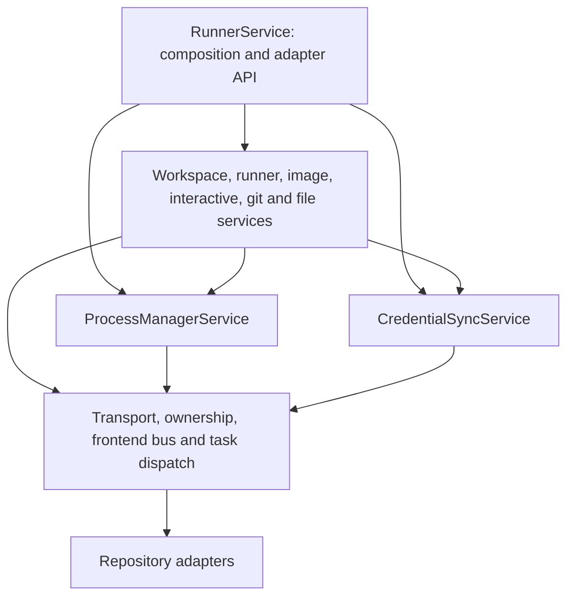

# Runner application services

`RunnerService` is the composition root and compatibility facade used by REST,
Socket.IO, MCP and the harness. Its methods preserve the existing signatures and
delegate to named service instances. Domain behavior does not inherit from the
facade, reach into it, or depend on sibling methods appearing on a shared `self`.
New internal callers should request the narrow service they need.

Each domain and infrastructure service has a keyword-only constructor listing its
repositories and collaborators. No constructor accepts a `RunnerService` or an
untyped shared context. `RunnerRepositories` selects persistence adapters when
constructing the application; individual services receive only their own adapters.

The dependency graph follows these layers:

Workspace admission is supplied by `OwnershipService`; dispatch goes through
`RunnerTransportService`; frontend projection goes through `FrontendBusService`.
Heartbeat reconciliation coordinates the workspace lifecycle, process management,
and session observations through their explicit service references. The facade
coordinates durable operation-result callbacks and adapts harness desktop calls.
Credential acknowledgement uses a named result callback instead of depending on
all facade methods. Pure operation labels and file-chunk validation are supplied
as typed functions, so those infrastructure services need no domain instance.

Mutable process-local state has a single owner:

| State | Owner |
| --- | --- |
| Pending process and git RPCs | `RpcRegistryService` |
| Git serialization locks | `GitOperationsService` |
| Credential deliveries awaiting reconciliation | `CredentialSyncService` |
| Process verification work from heartbeats | `HeartbeatReconcilerService` |
| Terminal routes, desktop observations, epochs and generation tombstones | `InteractiveSessionState` |

The interactive state object is created once per facade and explicitly supplied
to session storage, interactive sessions and ownership checks. No mutable state
lives on a service class. A second facade gets separate maps and locks. The
application singleton remains a composition convenience, not a prerequisite for
correct instance isolation. Read-only compatibility properties on the facade
expose the existing inspection API without creating another copy of this state.

Services can be tested directly. For example, a process-RPC test constructs
`ProcessManagerService` with a fake runner transport and a real
`RpcRegistryService`; it needs no partially initialized facade or sibling mixins.
Tests that replace behavior patch the owning service or inject a repository at
construction. `test_service_composition.py` covers standalone RPC success,
timeout, cancellation, transport failure, ownership rejection, repository
injection and state isolation. Existing runner tests exercise adapter-facing
behavior through the composed facade.
