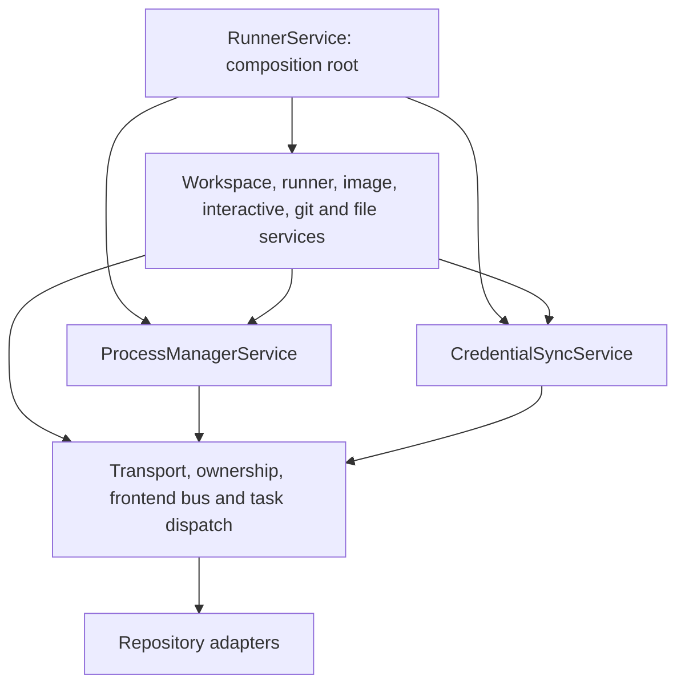

# Runner application services

`RunnerService` is the composition root: it wires the domain and infrastructure
services once per process and exposes them as attributes. REST, Socket.IO, MCP
and the harness call the owning service directly, e.g.
`get_runner_service().workspace_lifecycle.stop_workspace(...)`. Domain behavior
does not inherit from `RunnerService`, reach into it, or depend on sibling
methods appearing on a shared `self`.

Each domain and infrastructure service has a keyword-only constructor listing its
repositories and collaborators. No constructor accepts a `RunnerService` or an
untyped shared context. `RunnerRepositories` selects persistence adapters when
constructing the application; individual services receive only their own adapters.

The dependency graph follows these layers:

Workspace admission is supplied by `OwnershipService`; dispatch goes through
`RunnerTransportService`; frontend projection goes through `FrontendBusService`.
Heartbeat reconciliation coordinates the workspace lifecycle, process management,
and session observations through their explicit service references. The root
coordinates durable operation-result callbacks and adapts harness desktop calls.
Credential acknowledgement uses a named result callback. Pure operation labels
and file-chunk validation are supplied as typed functions, so those
infrastructure services need no domain instance.

Mutable process-local state has a single owner:

| State | Owner |
| --- | --- |
| Pending process and git RPCs | `RpcRegistryService` |
| Git serialization locks | `GitOperationsService` |
| Credential deliveries awaiting reconciliation | `CredentialSyncService` |
| Process verification work from heartbeats | `HeartbeatReconcilerService` |
| Terminal routes, desktop observations, epochs and generation tombstones | `InteractiveSessionState` |

The interactive state object is created once per `RunnerService` and explicitly
supplied to session storage, interactive sessions and ownership checks. No
mutable state lives on a service class. A second `RunnerService` gets separate
maps and locks. The application singleton remains a composition convenience, not
a prerequisite for correct instance isolation. Tests inspect state directly on
its owning service.

Services can be tested directly. For example, a process-RPC test constructs
`ProcessManagerService` with a fake runner transport and a real
`RpcRegistryService`. Tests that replace behavior patch the owning service or
inject a repository at construction.
