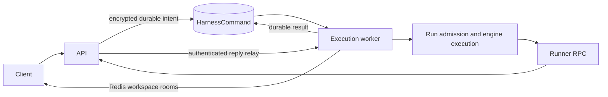

# API and execution ownership

The API accepts HTTP/Socket.IO traffic and reads persisted conversations. It
submits live operations as `HarnessCommand` records. `execute_harness` owns native
agent tasks, interaction waiters, the scheduler, push jobs and recovery. Restarting
an API process does not cancel its already submitted commands or running agents.

Commands have three states: `queued`, `claimed`, `completed`. A transaction claims
one queued request and binds it to a worker UUID. Only that owner can complete it;
database constraints reject invalid state combinations. Results include either
a value or a typed service error. Payloads/results use the existing credential
encryption implementation. Completion erases the extra request-payload copy.
Session deletion does not delete the command waiting to report its result.

The worker reserves separate bounded capacity for admission and controls: up to
eight start/edit requests and 32 control requests execute concurrently. Additional
requests stay queued in storage. Claim selection skips saturated admission work,
so permission responses and aborts retain capacity while workspace/provider
preparation is blocked. Admission capacity is released only after the request's
terminal result has been persisted. A stop/deletion also settles earlier queued
start/edit requests for that session. It validates and records explicit stop
intent, then cancels and joins older claimed admission waiters before dispatching
the stop/deletion. This includes tasks still loading their session or rolling
back. A task already cancelling is joined without another cancellation. Later
starts remain queued behind earlier pending stops until their cleanup completes;
unrelated sessions continue to use available capacity.
API request cancellation leaves committed intent intact. Graceful worker shutdown stops queue
admission, cancels outstanding request waiters, settles their durable responses,
then interrupts and joins owned run trees. Result-storage failures retry persistence
without repeating effects. Cancellation while a result is being written or
waiting for retry cannot replace that already selected outcome.

Run submission includes an immutable settings snapshot (mode, agent, model,
reasoning effort, engine and skill identities). Dispatch rejects a stale queued
configuration with `run_configuration_changed`; it never silently substitutes
later settings. Skill-persistence rereads preserve the captured execution options.
Edits capture defaults at submission while preserving explicit requested overrides.
Admission joins committing writes and captures their persisted identities before
propagating cancellation, so rollback can always find message shells, provider
holders, external attempts and committed edits.

Shutdown closes admission, cancels and joins core work without recording a user
abort, then drains metadata holders, revocation listeners and callback-created
cleanup through the background-task supervisor. Unconfirmed external cleanup keeps
its durable answer holder and CLOSING fence for recovery.

The execution process holds a file lock for its full lifetime and the scheduler
holds its existing database lease. The API gateway holds neither execution lock. On
execution startup, existing native-run recovery settles lost task trees. Claimed
commands from the dead process complete with `execution_interrupted`; they are
never rerun because their effects might already exist. Queued commands survive.
External engine runs retain their durable runner cleanup/ownership fences.

Frontend subscriptions are authorized by the Socket.IO API adapter before joining
`workspace:<id>` rooms. Workers publish to those shared rooms without inspecting
local frontend connections. Runner replies enter through authenticated API
handlers and reach their owning execution/API process through an internal Redis
relay; pending-request correlation still validates runner/workspace identities.
API and execution processes each start `apps.runners.reply_routing`. The relay
awaits its Redis subscription acknowledgement before declaring readiness, routes
custom harness/git/process/stream replies to the process owning their correlation
IDs, preserves byte-stream acknowledgements, and forwards disconnect notices to
fail remote streams. Large chunks remain transient and never enter the database.
Steering queues have an encrypted persisted reconnect projection; only the live
execution owner mutates the authoritative queue.

When upgrading from the combined ASGI/execution process, stop that old backend
before starting the new execution worker. Run `python manage.py migrate` before
deploying matching API/execution versions.
Start `python manage.py execute_harness` separately from Uvicorn; Compose provides
an `execution` service with the same database, Redis and encryption environment.
Use one execution worker per database. SQLite lock storage is adjacent to its
file. For PostgreSQL on multiple hosts, set `EXECUTION_PROCESS_LOCK_PATH` to the
same shared file for execution contenders. Keep one realtime API gateway: its
terminal and desktop connection state is local. Execution is independently
restartable; replicated realtime gateways need a separate ownership design for
those connection resources before increasing the gateway worker count.
