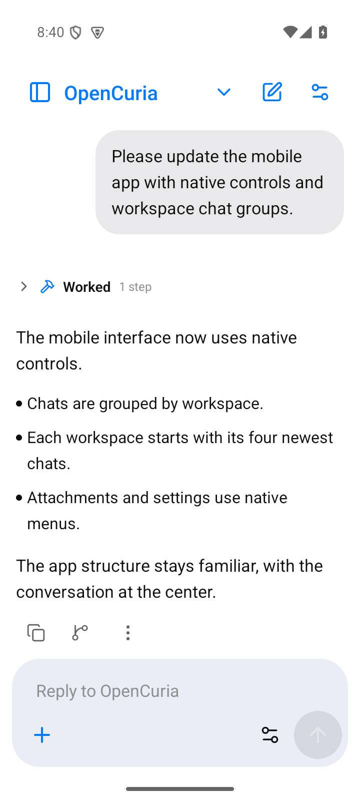
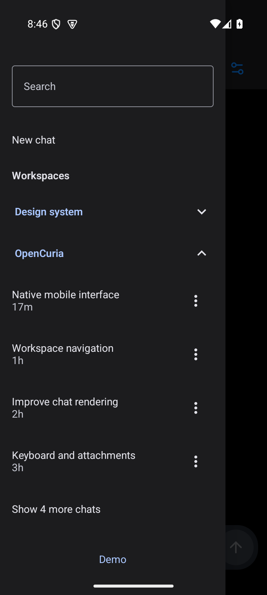
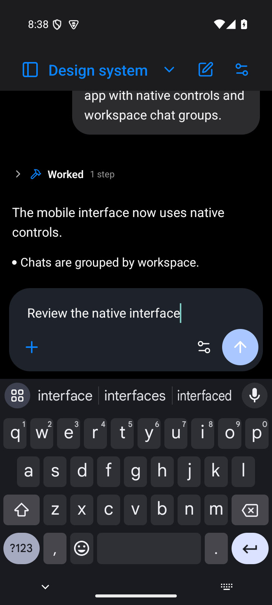
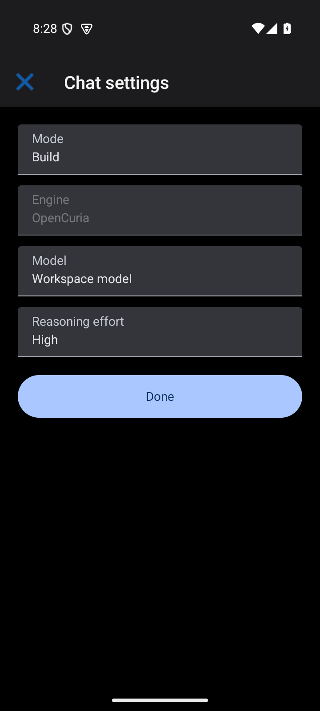
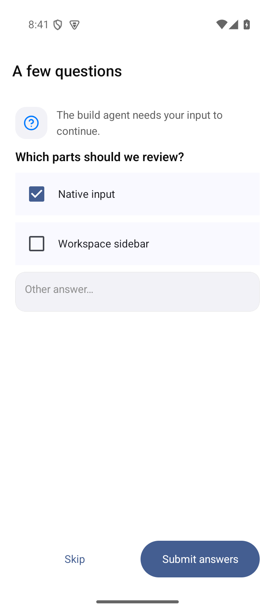

# Native UI verification

Verified on 2026-10-26 after replacing the mobile controls with SwiftUI/UIKit and Material/Android controls, following the read-only t3code reference. The app structure and shared chat protocol remain in place. Sidebar eligibility, inbox and ordering now come from the same shared helpers as the webapp; each workspace initially shows four chats and paginates independently. Scheduled tasks remain outside mobile.

## Automated checks

| Check | Result |
| --- | --- |
| Root `npm run type-check` (web, mobile, client) | Passed |
| Mobile logic | 67 passed |
| Mobile UI | 44 passed across 9 suites |
| Shared core/client | 107 passed |
| Web conversation helpers and sidebar components | 73 passed |
| Android and iOS Hermes export | Passed |
| Android x86_64 debug APK, including the local native Toolbar module | Built successfully |

The UI suite tests application behavior with platform controls mocked at their boundary. Native rendering and interaction were checked separately in the Android development client. Sidebar tests cover independent four-chat pagination, collapsed groups, older active chats, inbox/offline rules, search, organization changes and disabled mutations during workspace transitions. Native modal tests guard unresolved permission/question requests against swipe/back dismissal.

## Native Android checks

Used a disposable, read-only Android API 35 emulator at 720×1600 and a separate local API/Socket.IO fixture with two running workspaces, one stopped workspace and more than four chats per group. No external provider runs or production data were used.

- Native login fields and keyboard focus, account settings, light/dark appearance.
- Android drawer navigation, native workspace list, four default chats, paging and collapse retention.
- Native search finding older chats across workspaces.
- Native chat editing with the composer completely above the keyboard, including its send and attachment actions.
- OS attachment popup and user-message context menu; native tool-detail disclosure.
- Native model dropdowns and settings dialog; the engine remains fixed for existing sessions.
- Native rename field and AppCompat modal Toolbar, including its close action.
- Native question checkboxes, submission and blocked Android Back dismissal while a request is unresolved.

The main editor keeps the OS multiline text input (`UITextView` / `EditText`). Keyboard avoidance measures its actual position beneath native navigation bars. Android modal screens use a local Expo module exposing the actual AppCompat Toolbar; iOS uses SwiftUI navigation bars. No JavaScript bottom-sheet presentation is used.

## Screenshots

Unedited captures from the Android development client with sample data:

| Chat | Workspace sidebar |
| --- | --- |
|  |  |

| Keyboard | Settings | Question |
| --- | --- | --- |
|  |  |  |

## Remaining platform validation

iOS JavaScript/Hermes export passed. Native iOS compilation, device appearance, split-view behavior and keyboard acceptance require macOS/Xcode and have not been verified here. Native release signing and store submission were not part of this change. Rebuild the development client to include the new native dependencies and local Android module.
