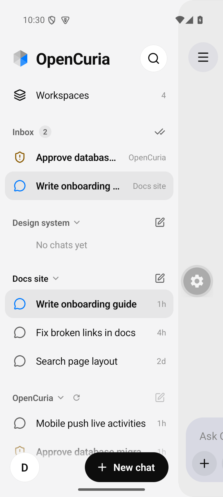
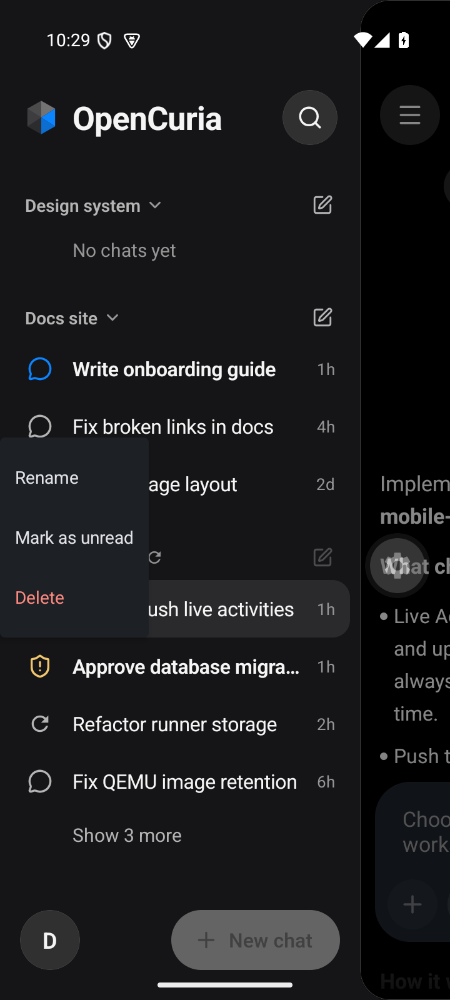
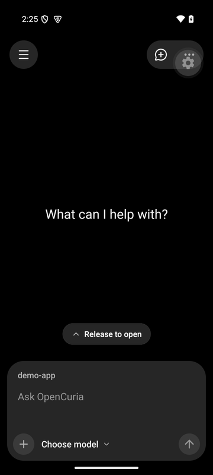
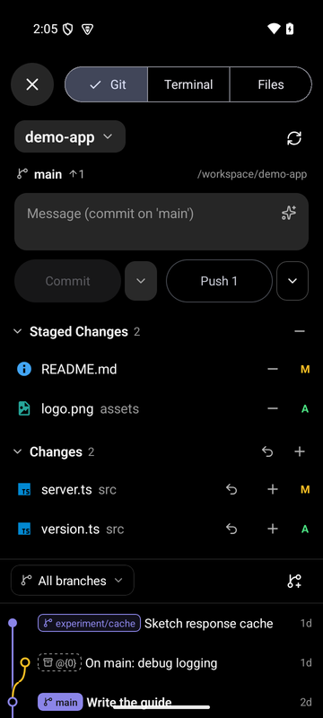
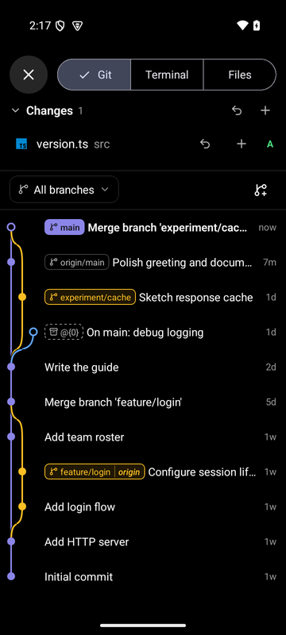
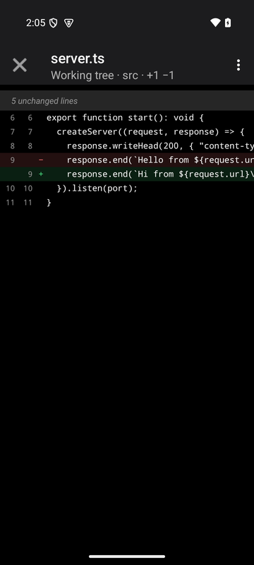
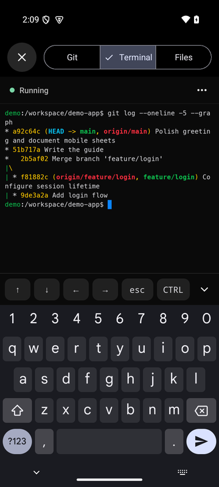
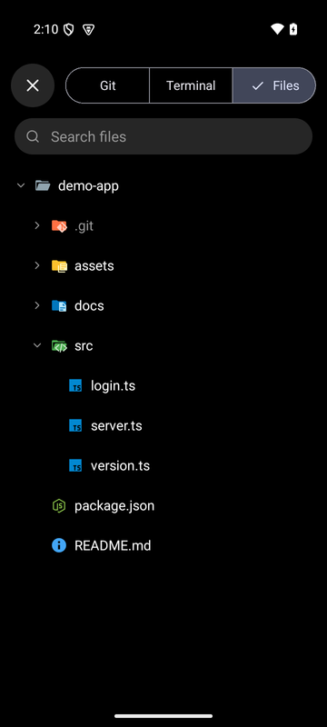
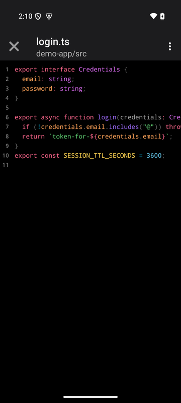
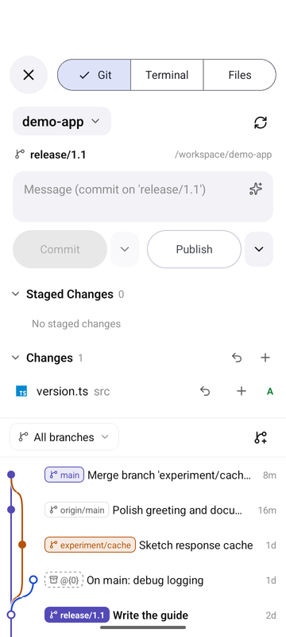

# Native UI verification

Verified on 2026-10-26 after replacing the mobile controls with SwiftUI/UIKit and Material/Android controls, following the read-only t3code reference. The app structure and shared chat protocol remain in place. Sidebar eligibility, inbox and ordering now come from the same shared helpers as the webapp; each workspace initially shows four chats and paginates independently. Scheduled tasks remain outside mobile.

## Automated checks

| Check | Result |
| --- | --- |
| Root `npm run type-check` (web, mobile, client) | Passed |
| Mobile logic | 67 passed |
| Mobile UI | 44 passed across 9 suites |
| Shared core/client | 107 passed |
| Web conversation helpers and sidebar components | 73 passed |
| Android and iOS Hermes export | Passed |
| Android x86_64 debug APK, including the local native Toolbar module | Built successfully |

The UI suite tests application behavior with platform controls mocked at their boundary. Native rendering and interaction were checked separately in the Android development client. Sidebar tests cover independent four-chat pagination, collapsed groups, older active chats, inbox/offline rules, search, organization changes and disabled mutations during workspace transitions. Native modal tests guard unresolved permission/question requests against swipe/back dismissal.

## Native Android checks

Used a disposable, read-only Android API 35 emulator at 720×1600 and a separate local API/Socket.IO fixture with two running workspaces, one stopped workspace and more than four chats per group. No external provider runs or production data were used.

- Native login fields and keyboard focus, account settings, light/dark appearance.
- Android drawer navigation, native workspace list, four default chats, paging and collapse retention.
- Native search finding older chats across workspaces.
- Native chat editing with the composer completely above the keyboard, including its send and attachment actions.
- OS attachment popup and user-message context menu; native tool-detail disclosure.
- Native model dropdowns and settings dialog; the engine remains fixed for existing sessions.
- Native rename field and AppCompat modal Toolbar, including its close action.
- Native question checkboxes, submission and blocked Android Back dismissal while a request is unresolved.

The main editor keeps the OS multiline text input (`UITextView` / `EditText`). Keyboard avoidance measures its actual position beneath native navigation bars. Android modal screens use a local Expo module exposing the actual AppCompat Toolbar; iOS uses SwiftUI navigation bars. No JavaScript bottom-sheet presentation is used.

## Sidebar (2026-10-27)

The Claude-style sidebar replaced the separate chat-list page and the native list rows. Checked in a rebuilt Android development client (API 35, 720×1600) against a disposable local fixture with three running workspaces, a stopped one, Inbox entries, a busy chat and a waiting permission gate:

- Menu button, horizontal swipes from mid-screen (open and close), tap on the visible chat edge and Android Back; vertical drags do not move the sidebar. A swipe starting at the screen edge is the Android Back gesture.
- Inbox, grouped workspaces, four chats with Show more, collapse, the pen's New chat per workspace, selected row, search with Cancel (closes the keyboard), account sheet and workspace picker.
- Long-press Material menu (Rename, Mark as read/unread, Delete) reaching the server.
- Light and dark appearance.

iPhone uses the same `SlideDrawer` and sidebar; its UIContextMenu, liquid-glass header and gestures still need a check on a Mac/iPhone.

## Screenshots

Unedited captures from the Android development client with sample data:

| Chat | Sidebar | Sidebar (light) | Chat menu |
| --- | --- | --- | --- |
|  |  |  |  |

| Keyboard | Settings | Question |
| --- | --- | --- |
|  |  |  |

## Workspace tools (2026-10-31)

Checked in a rebuilt Android development client (API 35, 720×1600, x86_64) with the local `opencuria-terminal` (libghostty-vt) and `opencuria-highlights` modules. A disposable local fixture served the mobile REST/Socket.IO contract; Git and file requests ran through the runner's own `GitService` and `FileManager` against a sample repository bind-mounted at `/workspace`, and the terminal was a real PTY shell. No provider runs, VMs or production data were used.

- Pull up at the end of a chat (also an empty chat) shows the hint, then "Release to open"; scrolling up and back down to the end in one drag, momentum and short drags do not open the sheet. The chat menu's "Git, Terminal & Files" opens it as well.
- Git: repository/branch header with ahead count, stage from the diff menu, generated commit message, Commit & Push (commit appears on `main` and `origin/main`), branch badge menu with a confirmed merge, long-press commit menu, Create Branch Here (checked out), commit details and per-file diffs with syntax highlighting.
- Terminal: native surface with colours, key row above the keyboard (history ↑, CTRL+C), dismiss/show keyboard.
- Files: lazy tree with the webapp icons, search, highlighted source, Markdown, CSV table and image previews.
- Light and dark appearance.

| Pull up | Git | Graph | Diff |
| --- | --- | --- | --- |
|  |  |  |  |

| Terminal | Files | Viewer | Light |
| --- | --- | --- | --- |
|  |  |  |  |

iOS: the Android and iOS Hermes exports pass. The iOS terminal (GhosttyKit/Metal), the SwiftUI headers and the highlighter's Swift bridge are not compiled here; build the development client on a Mac before relying on them.

## Remaining platform validation

iOS JavaScript/Hermes export passed. Native iOS compilation, device appearance, split-view behavior and keyboard acceptance require macOS/Xcode and have not been verified here. Native release signing and store submission were not part of this change. Rebuild the development client to include the new native dependencies and local Android module.
