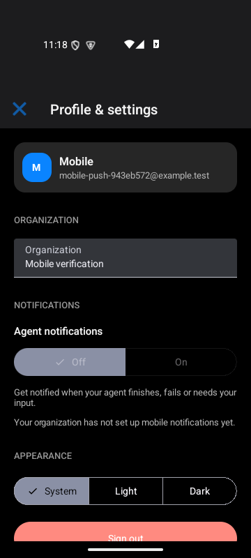
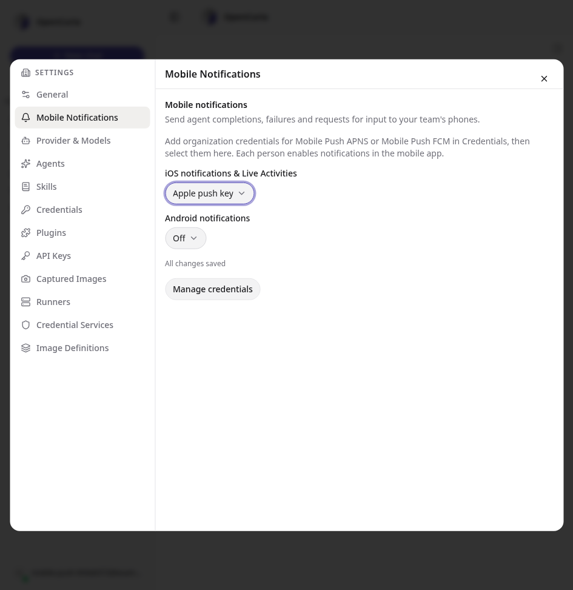

# Mobile push and Live Activity verification

Verified in the isolated Linux workspace on 2026-10-26 with Expo SDK 57.
See [setup and delivery behavior](mobile-notifications.md) for configuration.

## Automated checks

| Check | Result |
| --- | --- |
| Notifications, credential services/API, plugin runtime/API and MCP | 164 passed |
| ASGI lifespan integration | 1 passed |
| Harness, scheduler and external-engine regression selection | 135 passed; 22 existing prerequisite skips |
| Mobile lifecycle, navigation targets, storage and signing configuration | 85 passed |
| Mobile native component/session tests | 53 passed across 10 suites |
| Shared chat core and API client | 108 passed |
| Full web suite, single worker | 2,162 passed across 210 files |
| Root web/mobile/client TypeScript | Passed |
| Web production build | Passed |
| Changed web files, ESLint | Passed |
| New mobile files/configuration, Prettier | Passed |
| Backend checks and migration drift | Passed; migrations applied locally |
| Android and iOS production Hermes exports | Passed |
| Android x86_64 development APK | Built and installed successfully |
| iOS prebuild and generated signing metadata | Passed |
| Root critical-severity npm audit | Passed; existing moderate/high advisories remain |

The notification tests verify native/Claude/Codex completion events, stopped runs,
subagent gates, pending-gate and completion repair, idempotency, claimed-job leases,
fenced acknowledgements, provider retries, token replacement and invalidation,
account/membership/workspace/organization authorization, stale attention suppression,
payload limits and server-only vault boundaries. Provider tests verify signed
APNs/FCM requests against mock HTTP transports without contacting Apple or Google.
The iOS alert contract is checked against Expo's native `userInfo["body"]` format;
Android custom data remains flat FCM data.
Concurrent conversations in one workspace keep independent attention states;
nested child gates prioritize and link to their own root conversation.

Mobile tests cover permission denial, explicit opt-in, foreground suppression,
cold-start targets, inaccessible conversations, temporary network failures,
SecureStore failures, native token events emitted during token reads, activity
token replacement, multiple instances and foreground-only creation. Revocation is
confirmed before account/organization changes, including a lost opt-in/rollback
response; late listeners cannot re-register a revoked account.

Ruff passes for changed Python files. `config/settings/base.py` retains the same
three pre-existing E501 findings as HEAD; its new lines pass all rules.
Existing Django/Ninja deprecation warnings were not suppressed.

## Native and browser checks

Built the native Android development APK with the new Expo modules, installed it
on an isolated read-only API 35 emulator and connected it to the real local backend.
Verified sign-in, profile/settings rendering, the disabled state for an organization
without FCM configuration, no unsolicited OS permission prompt, and confirmed
sign-out returning to the login screen. Native logcat had no remaining runtime
errors. The disposable account, organization, credentials and workspace were
removed after verification.

The Android check also caught and fixed SDK-specific default channel sound handling.
Native source inspection caught the token-read event feedback loop; a regression
test now proves that reading a token causes only one registration.

The web admin settings were checked in headed Playwright against the real backend,
including selecting an organization vault credential and successful autosave.
No production credentials or external agent runs were used.

| Android native settings | Organization provider configuration |
| --- | --- |
|  |  |

The iOS prebuild generated the Expo Widgets extension, matching application groups,
`NSSupportsLiveActivities` and a valid `aps-environment=development` entitlement.
Development, production and production-signed development configurations are also
tested separately. Registration reads the installed native identity and provisioning
environment, so changing Metro's build variables cannot change the installed APNs
destination. The widget Babel output was checked for serialization and executed
in isolation with SwiftUI globals to verify all Lock Screen/Dynamic Island regions
and attention prioritization without capturing application imports.

## Remaining device acceptance

No Apple/Firebase delivery credentials, macOS/Xcode or provisioned iPhone were
available. This verifies implementation, native Android integration and bundle/
prebuild generation; it does not claim successful remote provider delivery or an
iOS native compile. The Android development build without Firebase configuration
is not a push-enabled release package.

Before release, follow the setup guide to configure APNs and Firebase, rebuild and
sign the native clients, then verify actual notification receipt in foreground,
background and cold start on both platforms. On iPhone, verify activity token
registration, Lock Screen and Dynamic Island presentation, update/end after locking
or terminating the app, system revocation, multiple runs/devices, account changes
and backend/network recovery. New activities are created in the foreground, as in
the referenced t3code implementation; server pushes update/end existing activities.
