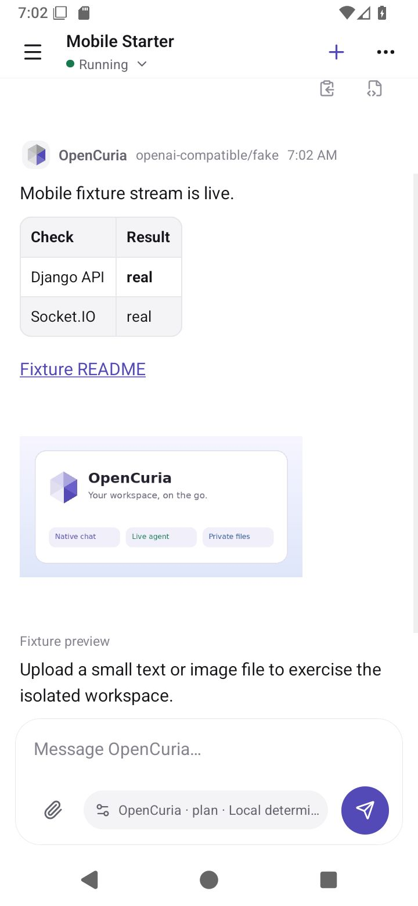
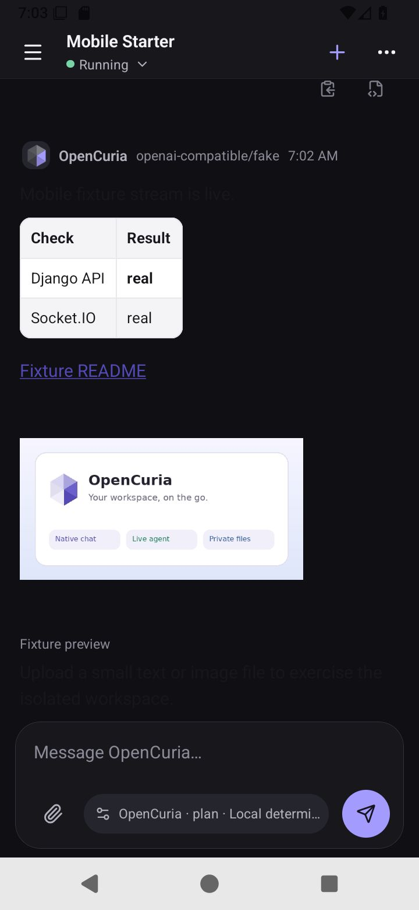
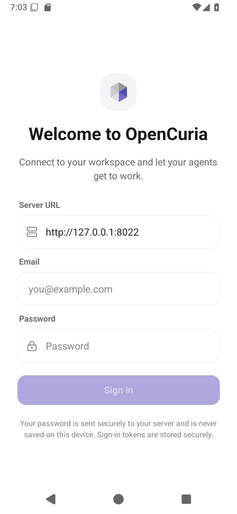
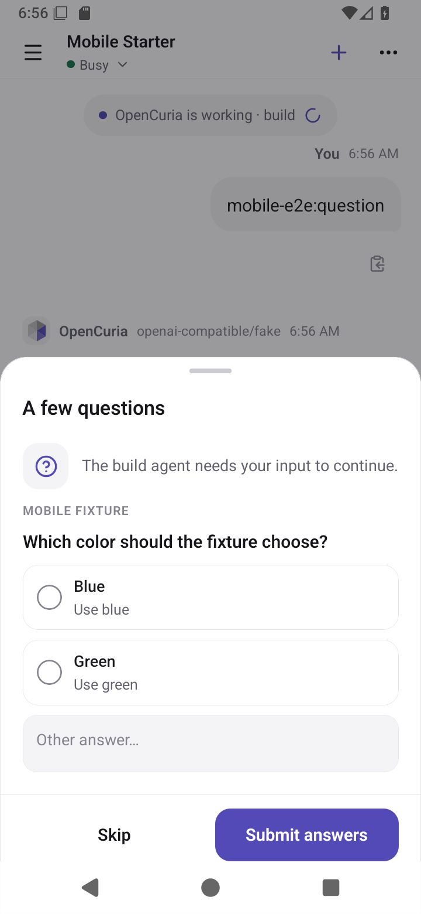

# Mobile V1 verification

Verified in the isolated Linux workspace on 2026-10-17. The application is the actual Expo/React Native app, not a web mock. Feature implementation: `7b3678b` on `feat/expo-mobile-app`.

## Local test gate

The complete `.githooks/pre-commit` gate passed, including the hook executed by the implementation commit:

| Suite | Result |
| --- | --- |
| Backend | 2,913 passed; 28 explicitly skipped |
| Runner | 794 passed; 6 explicitly skipped; 26 subtests passed |
| Shared chat core | 8 passed |
| Shared API/realtime client | 23 passed; optional live test skipped in the ordinary unit gate |
| Mobile controller/platform/config | 37 passed |
| Mobile native component/session tests | 24 passed |
| Webapp | 1,935 passed across 193 files |
| Web/mobile/shared TypeScript | passed |

The opt-in shared-client live test also passed separately against the fixture server. Existing deprecation warnings, a Webapp test's Pinia injection warning, and some existing mocked coroutine warnings remain visible; they were not suppressed.

A pytest-only password-hasher override uses MD5 for disposable test users, retaining PBKDF2 as a fallback. This avoids thousands of expensive production password hashes during tests and does not alter production or development server authentication settings. Tests are not skipped or assertions removed.

## Build checks

- Actual Android x86_64 development APK: `mobile/android/app/build/outputs/apk/debug/app-debug.apk`, API 36, minimum API 24, `org.opencuria.mobile.dev`.
- Final native rebuild passed with all included native modules. SHA-256: `477b18c7426fe0128032f895aee68492d3bcd6ccb81287c4e88d77ae10dbbc57`.
- Expo production Hermes exports passed for **Android and iOS**. This is a JavaScript/native-ABI bundle check, not an iOS native build.
- Webapp production build and type-check passed.
- All 20 existing browser regressions for chat image previews and workspace/chat navigation passed in a complete sequential rerun. Two initial dev-server warm-up failures passed individually and on the full rerun; no assertions were removed and retries stayed disabled.
- The compiled production app's virtualized streaming/transcript-cache benchmark passed against controlled HTTP/Socket.IO fixtures.
- Webapp Docker image built from the repository-root context, started locally, and served the compiled app and generated `/config.json`.
- Production Expo introspection confirmed `org.opencuria.mobile` and `android:usesCleartextTraffic="false"`; development uses the separate `.dev` identifier.
- Root workspace critical-severity npm audit passed. Moderate/high transitive advisories remain; passing the configured critical-only gate does not mean the dependency graph is vulnerability-free.

On this 4-GB VM, native compilation and an emulator must not run concurrently. The reproducible low-memory Gradle invocation was:

```sh
cd mobile/android
CMAKE_BUILD_PARALLEL_LEVEL=1 ./gradlew :app:assembleDebug --no-daemon \
  -PreactNativeArchitectures=x86_64 \
  -Pkotlin.compiler.execution.strategy=in-process \
  -Dorg.gradle.workers.max=1 \
  -Dorg.gradle.jvmargs='-Xmx1024m -XX:MaxMetaspaceSize=384m'
```

## Native Android acceptance

Target: Android 16/API 36 x86_64 emulator, 720×1560 logical screen, Expo development client. `e2e/mobile/android_ui.py` passed against the **real Django REST/JWT/Harness/Socket.IO layers** and the documented deterministic provider/runner stand-ins.

Automated acceptance observed:

- restored authenticated startup and available workspace/new-chat state;
- actual Socket.IO-backed `@README` file lookup and insertion;
- `/` skill selection and selected-skill chip;
- streamed Markdown/table and an authenticated `/workspace/preview.png` image, including full-screen preview;
- real persisted question and permission gates, user response/approval, and resumed runs;
- stop/abort with an empty draft;
- existing 80-message history and foreground reconnect;
- light/dark native appearance.

Additional UIAutomator-driven checks observed camera capture, photo-library selection, document selection and upload, edit/rerun, fork, rename, read/unread, deletion, mode/model selection, logout/re-login and switching to an empty second organization and back. The uploaded document's bytes and selected image's bytes matched the fixture files. Camera/gallery return retained the pending attachment after the app resumed.

The protocol smoke additionally checks cross-user/cross-tenant denial, read-only API-key permissions, busy-409, lifecycle actions, and a 420,032-byte chunked upload with byte-exact authenticated read/download and on-disk verification. A foreign-organization header is denied by the existing backend with HTTP 500 rather than a clean 4xx; the fixture records this behavior, not a successful access. This pre-existing error-format issue is not represented as mobile authorization bypass or fixed by the client.

## Actual running screenshots

These are captures of the installed native app connected to the isolated fixture, with deterministic sample content. No screenshot is a UI mock.

| Light chat and private image | Dark chat |
| --- | --- |
|  |  |

| Login after logout | Agent question gate |
| --- | --- |
|  |  |

Workspace-local raw artifacts: `/workspace/.opencuria/playwright/mobile/`. Private fixture state/passwords/tokens are not committed.

## Explicit remaining limits

- No macOS/Xcode environment was available: **iOS native compilation, signing, simulator and iPhone acceptance have not been performed**. Run the documented Mac checks before an iOS release.
- No physical Android handset, app-store distribution, production signing or external LLM/Docker/QEMU run is claimed. The isolated fixture intentionally uses a deterministic local provider and confined runtime/file stand-ins.
- A development APK requires Metro. No standalone signed release package or cloud build was requested.
- The first GitHub Actions run passed Webapp, Mobile and Security Audit but failed its Backend and Runner jobs despite the complete local gate being green. Detailed hosted logs were unavailable with the current repository rights. A clean local runner installation also passed all 794 tests; the clean backend installation also passed all 2,913 tests. CI now retains JUnit reports and emits failing test identities as annotations, so hosted failures are inspectable without weakening tests or adding retries.

### Hosted CI environment follow-up

The retained annotations identified pre-existing portability assumptions exposed
by the new feature-branch CI: QEMU fixture tests require `qemu-img`, the recovery
installer-preview test expects `backend/.venv/bin/python`, and one real-subprocess
stream test assumed the host has `/workspace`. CI now installs `qemu-utils` and
creates the expected backend virtualenv; the stream test uses its pytest scratch
directory. The unborn-repository Git fallback now tests whether HEAD exists
instead of matching a version-/locale-specific English stderr string; its
regression verifies worktree content is retained. These checks are not skipped.

A subsequent hosted run exposed an existing one-second initialization race in
the inventory/heartbeat independence test. Its event waits now have a bounded
ten-second CI budget and tasks are always cancelled in `finally`; assertions
still prove heartbeat/replay runs while the inventory scan is blocked. No
production heartbeat timeout or interval was changed.

The remaining hosted timeout was traced to host uptime, not heartbeat speed:
the test inherited a 120-second inventory interval, while a fresh CI VM's
monotonic clock could still be below 120 seconds. The test now explicitly uses
`inventory_interval=0` to force its first inventory tick, rather than depending
on the host's age. The event-based blocked-scan assertions remain intact.
