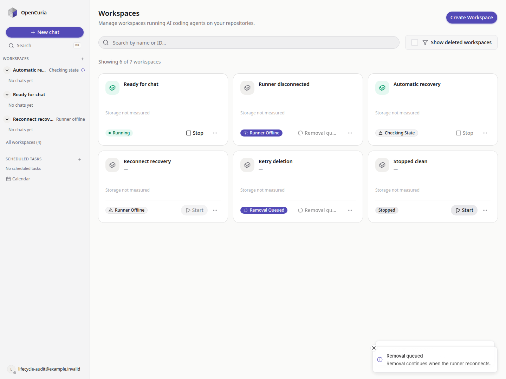
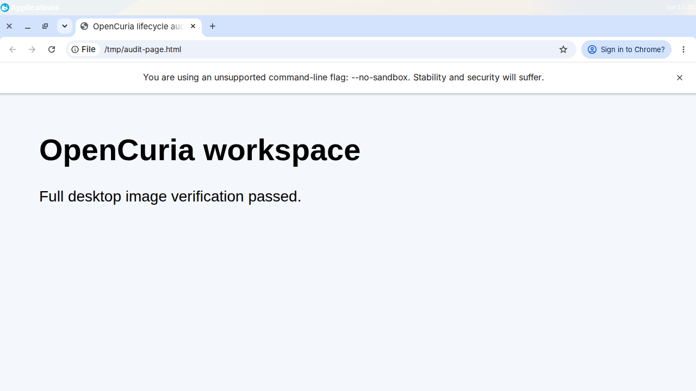

# Image and workspace lifecycle audit — Completed

578 cases; 578 PASSED; 0 open.

Expectations were recorded before execution. The [original frozen plan](lifecycle-evidence/plan-before-execution.md), explicit continuation addenda and exact evidence remain available. New findings were added before their regression tests ran. Catalog entries are acceptance groups; parametrized executable tests and broad suite totals are reported separately.

## Changes and state model

- Removed the redundant backend/API workspace `removed` status; migration 0031 normalizes old rows to `deleted`. Runtime removal remains a transport observation.
- Execution outcome, delivery/proof phase and parent workflow phase remain distinct because they authorize different effects. The legacy internal `intervention` phase now waits for automatic verification; ordinary interruption recovery requires no administrator acknowledgement.
- Unknown initialization is never replayed. Exact, fresh, sealed quiescence closes interrupted history into a retryable failure. Partial files stay until an ordinary authorized remove; durable allocation lineage allows exact lost-cache cleanup and completed removal revokes stale ownership.
- Capacity includes retained and stopped disks, unresolved operations, parent workflows and confirmed sizing after failed settings changes. Undelivered actions on existing guests never claim physical absence. Disk shrink and invalid activation requests fail before mutation.
- Publication integrity is separate from dependency graph completeness. A readable corrupt image becomes unusable, while unrelated cleanup proceeds and backing dependencies remain protected. Unreadable backing metadata still blocks destructive work.
- Direct, discovered and inventory power-state observations now agree. Explicit paused, crashed, suspended, stopping or unknown guests cannot remain chat-ready. Non-stopped observations revoke stale credential scrub proof. Missing rows cannot prove absence.
- UI eligibility is shared across list and detail actions. Normal users can retry failed deletion and queue removal while offline. Pending/recovery states have clear labels and block conflicting actions. Invalid resource inputs are rejected before mutation.
- Fresh runtime startup creates every configured owned storage root, including the image cache. A first inventory before any download is complete; permission errors fail startup clearly instead of silently stranding recovery.
- Invalid current image publications also project a failed assignment in the image summary. Rebuilds enter pending even while the old pointer is retained; a failed successor cannot restore an unusable predecessor to active. Newer generations and deletion/deactivated state remain protected.

All implementation edits stayed in this repository; reference repositories and existing user work were preserved. At historical audit completion, no commit or external deployment had yet been performed. Later integration and publication are documented separately.

## Final verification

| Check | Result | Evidence |
|---|---|---|
| Backend complete baseline — SQLite | 1501 passed; 21 skipped; final projection delta tested separately below | [JUnit](lifecycle-evidence/backend/sqlite-final-verified.xml) |
| Backend complete baseline — PostgreSQL | 1521 passed; 1 skipped; final projection delta tested separately below | [JUnit](lifecycle-evidence/backend/postgres-verified.xml) |
| Final backend image-projection delta — SQLite | 161 passed; 19 skipped; 180 nodes, including 13 new B131–B134 nodes | [JUnit](lifecycle-evidence/backend/projection-final-sqlite.xml), [source scope](lifecycle-evidence/backend/final-verification.json) |
| Final backend image-projection delta — PostgreSQL | 180 passed; 0 skipped; 180 nodes, including 13 new B131–B134 nodes | [JUnit](lifecycle-evidence/backend/projection-final-postgres.xml), [source scope](lifecycle-evidence/backend/final-verification.json) |
| Runner complete suite | 1364 passed; 8 skipped; 36 subtests passed | [JUnit](lifecycle-evidence/runner/full-fresh-cache-final.xml) |
| Frontend complete suite | 2247 passed; 0 skipped | [JUnit](lifecycle-evidence/frontend/full-suite-green.xml) |
| Frontend production build, type check, touched-file lint | PASS | [Build](lifecycle-evidence/frontend/checks.json), [type check](lifecycle-evidence/frontend/checks.json), [lint](lifecycle-evidence/frontend/checks.json) |
| Headed production Chromium with isolated API fixtures | 16 assertions passed; 0 page errors | [Browser evidence](lifecycle-evidence/frontend/browser-smoke.json) |
| Real KVM lifecycle matrices — Ubuntu 22.04 and 24.04 | 64 cases passed; parallel builds and queued third build included | [22.04](lifecycle-evidence/vm/artifacts/ubuntu22/report.json), [24.04](lifecycle-evidence/vm/artifacts/ubuntu24-final/report.json) |
| Storage, hardware admission and guest failure boundaries | 5 cases passed | [Evidence](lifecycle-evidence/vm/artifacts/hardware-faults/report.json) |
| Real runner process SIGKILL recovery | 3 additional cases passed | [Evidence](lifecycle-evidence/vm/artifacts/crash-recovery/report.json) |
| Root verification harness lint/compilation, shell syntax and whitespace | PASS; final runner source fingerprint unchanged | [Checks](lifecycle-evidence/root-final-checks.json) |
| Backend architecture, lint and migration consistency | 13 architecture assertions pass on both databases; 50 Python files lint clean; no migration drift | [Review](lifecycle-evidence/backend/review.md), [migration check](lifecycle-evidence/backend/checks.json), [lint](lifecycle-evidence/backend/checks.json) |
| Complete standard desktop image recipes — Ubuntu 22.04 and 24.04 | Both passed: build/publication, boot/dependencies, real Xfce/KasmVNC, visible/headless Chrome, persistent stop/start; all test resources removed | [22.04](lifecycle-evidence/vm/artifacts/desktop22/report.json), [24.04](lifecycle-evidence/vm/artifacts/desktop24/report.json) |
| Test-resource cleanup and existing user workspace preservation | PASS; only original user guest and original networks remain; user guest XML and disk/seed inode, size and modification time unchanged | [VM/storage cleanup](lifecycle-evidence/final-cleanup.json), [database cleanup](lifecycle-evidence/backend/cleanup.json) |

## Coverage and interpretation

Verification ran at explicit hardening checkpoints. The real matrix reports retain their exact source digests; later power-observation/cache changes are covered by the complete final runner suite and subsequent fault, crash and desktop runs. Backend whole-suite baselines and the final bounded image-projection delta have separate frozen manifests and result files; earlier full-suite files named `*-complete` are intermediate evidence, not the final baselines.

Backend coverage enumerates durable command kinds, every capture/recreate child phase, task/delivery/session/identity/proof/ownership gates, fresh and stale observations, and CPU/RAM/disk admission. The frontend matrix covers all 8 canonical workspace states × 2 runner connection states × 2 recovery states, plus operation overlays, image lifecycle and settings bounds. Runner cases cover admission, journal durability, cancellation, replay, publication and dependency graphs.

The catalog represents finite reachable state and failure classes plus rejected invalid combinations. It does not claim every corrupt database or every physical hardware device was exercised. A catalog case may expand to several parameter combinations; broad suites and original U acceptance groups intentionally overlap detailed regression cases.

U007 is a cross-layer acceptance group: frontend tests prove image readiness/version selection and resource bounds; authoritative image disk minimum enforcement is tested by backend admission and real VM cases V016/V048. No client-local image-floor check is claimed.

Independent [coverage review](lifecycle-evidence/runner/coverage-review.md), [runner case map](lifecycle-evidence/runner/catalog-coverage.json), and [frontend case map](lifecycle-evidence/frontend/case-evidence-map.json) link planned cases to actual named results. Historical source manifests are included in the portable evidence bundle. Sensitive raw commands and logs remain in the original workspace and are not published.

## Hardware and outage boundaries

- Real KVM/libvirt, SSH, cloud-init and QCOW2: Ubuntu 22.04/24.04, parallel image initialization, a queued third build, mixed workspace actions, capture/clone, resource changes, paused guests and abrupt guest shutdown.
- Real separate runner processes receive SIGKILL during workspace initialization, image initialization, after committed publication and after partial disk allocation. Matching replay and ACK must preserve the exact result without rerunning recipes.
- Memory shortage is injected at the admission boundary while a real VM build waits without disk/network/domain allocation; removal of pressure lets it complete. Slow guest writes use actual libvirt disk throttling. ENOSPC uses a real isolated 2 MiB filesystem, preserving a known publication.
- Socket.IO startup outage, disconnection during execution, reconnect, duplicate delivery and ACK use a real loopback server with an isolated runtime substitute. Real VM transport-outage cases inject emission failure. These are distinct integration claims.
- Physical host power removal, defective RAM and SSD firmware/controller failure were not induced. Fully unreadable backing metadata requires restored storage or inspection. Arbitrary external replacement of owned resources is outside managed allocation lineage. Optional unavailable package/desktop fixtures are reported as skips, never acceptance passes.

## Earlier failures and corrections

Previous failed/interrupted raw runs remain in the original workspace-local evidence directory and are not included in the portable bundle. The first real matrix exposed an incorrect test query: operation-specific replay deliberately retains acknowledged tombstones; the pending queue must be queried without that selector. The standalone import bootstrap was then corrected after import sorting. Neither failed harness attempt is presented as a complete passing VM suite.

Earlier test-driver ownership fixtures modified only inactive XML while asserting live corruption; the final test boots the corrupt definition before checking refusal. Synthetic disk-only tests now isolate unrelated host RAM pressure while dedicated admission and real VM cases still test it. A stale sidebar assertion expected 'Stopped' for an explicitly offline runner; the corrected expectation and final complete frontend suite both pass.

An inherited interrupted-run publication had a mismatching SHA-256. Its manifest/digest evidence was preserved before exact disposable fixture cleanup. This exposed the unrelated-cleanup integrity/graph issue; the audit does not infer why the older artifact changed.

## Reproduction

See [lifecycle implementation and commands](../workspace-lifecycle-hardening.md). The opt-in scripts use fresh writable output directories and only local test data. Their output ancestors must be traversable by libvirt-qemu. Run suites sequentially on a shared host; each matrix exercises parallel operations internally.

The first V067 harness imposed a five-second full-inventory deadline, which was absent from its original responsiveness expectation. The revised predeclared protocol measures concurrent event-loop scheduling, SSH and unrelated guest stop separately, requires all of them while the throttled write is unfinished, then verifies the completed scan and write. Storage mutations may wait for the scan lock; cancellation drains issued IO. Both failed attempts and the precise protocol addendum are retained.

## Resource cleanup and visual evidence

The host exposes 4 logical CPUs and about 7.8 GiB RAM. Disposable VM disks, downloaded cloud-image fixtures, private test keys/journals and the isolated PostgreSQL databases/role were removed after their evidence was archived. About 19.6 GiB is free at completion. The existing user workspace stayed shut off and its XML, disk and seed metadata match the starting snapshot. [Cleanup evidence](lifecycle-evidence/final-cleanup.json), [resource samples and period](lifecycle-evidence/resource-summary.json).

The late resource sampler has a bounded timestamped period; it is not claimed as continuous telemetry for earlier checkpoints. Initial cleanup recovered about 8.7 GiB from exactly identified old disposable fixtures; no user base image, user disk or reference repository was removed.

## Backend

| ID | Scenario and expected outcome | Verification | Result |
|---|---|---|---|
| B001 | create_workspace, sealed interrupted journal, runtime running: release only this fence; failed; no script replay or resource deletion. | `test_automatic_recovery_matrix.py::test_interrupted_operation_matrix[create_workspace-running]` | PASSED |
| B002 | create_workspace, sealed interrupted journal, runtime stopped: release only this fence; failed; no script replay or resource deletion. | `test_automatic_recovery_matrix.py::test_interrupted_operation_matrix[create_workspace-stopped]` | PASSED |
| B003 | create_workspace, sealed interrupted journal, runtime absent: release only this fence; failed; no script replay or resource deletion. | `test_automatic_recovery_matrix.py::test_interrupted_operation_matrix[create_workspace-absent]` | PASSED |
| B004 | create_workspace_from_image_artifact, sealed interrupted journal, runtime running: release only this fence; failed; no script replay or resource deletion. | `test_automatic_recovery_matrix.py::test_interrupted_operation_matrix[create_workspace_from_image_artifact-running]` | PASSED |
| B005 | create_workspace_from_image_artifact, sealed interrupted journal, runtime stopped: release only this fence; failed; no script replay or resource deletion. | `test_automatic_recovery_matrix.py::test_interrupted_operation_matrix[create_workspace_from_image_artifact-stopped]` | PASSED |
| B006 | create_workspace_from_image_artifact, sealed interrupted journal, runtime absent: release only this fence; failed; no script replay or resource deletion. | `test_automatic_recovery_matrix.py::test_interrupted_operation_matrix[create_workspace_from_image_artifact-absent]` | PASSED |
| B007 | stop_workspace, sealed interrupted journal, runtime running: release only this fence; running; no script replay or resource deletion. | `test_automatic_recovery_matrix.py::test_interrupted_operation_matrix[stop_workspace-running]` | PASSED |
| B008 | stop_workspace, sealed interrupted journal, runtime stopped: release only this fence; stopped; no script replay or resource deletion. | `test_automatic_recovery_matrix.py::test_interrupted_operation_matrix[stop_workspace-stopped]` | PASSED |
| B009 | stop_workspace, sealed interrupted journal, runtime absent: release only this fence; failed; no script replay or resource deletion. | `test_automatic_recovery_matrix.py::test_interrupted_operation_matrix[stop_workspace-absent]` | PASSED |
| B010 | resume_workspace, sealed interrupted journal, runtime running: release only this fence; running; no script replay or resource deletion. | `test_automatic_recovery_matrix.py::test_interrupted_operation_matrix[resume_workspace-running]` | PASSED |
| B011 | resume_workspace, sealed interrupted journal, runtime stopped: release only this fence; stopped; no script replay or resource deletion. | `test_automatic_recovery_matrix.py::test_interrupted_operation_matrix[resume_workspace-stopped]` | PASSED |
| B012 | resume_workspace, sealed interrupted journal, runtime absent: release only this fence; failed; no script replay or resource deletion. | `test_automatic_recovery_matrix.py::test_interrupted_operation_matrix[resume_workspace-absent]` | PASSED |
| B013 | update_workspace, sealed interrupted journal, runtime running: release only this fence; running; no script replay or resource deletion. | `test_automatic_recovery_matrix.py::test_interrupted_operation_matrix[update_workspace-running]` | PASSED |
| B014 | update_workspace, sealed interrupted journal, runtime stopped: release only this fence; stopped; no script replay or resource deletion. | `test_automatic_recovery_matrix.py::test_interrupted_operation_matrix[update_workspace-stopped]` | PASSED |
| B015 | update_workspace, sealed interrupted journal, runtime absent: release only this fence; failed; no script replay or resource deletion. | `test_automatic_recovery_matrix.py::test_interrupted_operation_matrix[update_workspace-absent]` | PASSED |
| B016 | remove_workspace, sealed interrupted journal, runtime running: release only this fence; delete_failed; no script replay or resource deletion. | `test_automatic_recovery_matrix.py::test_interrupted_operation_matrix[remove_workspace-running]` | PASSED |
| B017 | remove_workspace, sealed interrupted journal, runtime stopped: release only this fence; delete_failed; no script replay or resource deletion. | `test_automatic_recovery_matrix.py::test_interrupted_operation_matrix[remove_workspace-stopped]` | PASSED |
| B018 | remove_workspace, sealed interrupted journal, runtime absent: release only this fence; delete_failed; no script replay or resource deletion. | `test_automatic_recovery_matrix.py::test_interrupted_operation_matrix[remove_workspace-absent]` | PASSED |
| B019 | build_image, sealed interrupted journal, runtime running: release only this fence; failed generation / prior current preserved; no script replay or resource deletion. | `test_automatic_recovery_matrix.py::test_interrupted_operation_matrix[build_image-running]` | PASSED |
| B020 | build_image, sealed interrupted journal, runtime stopped: release only this fence; failed generation / prior current preserved; no script replay or resource deletion. | `test_automatic_recovery_matrix.py::test_interrupted_operation_matrix[build_image-stopped]` | PASSED |
| B021 | build_image, sealed interrupted journal, runtime absent: release only this fence; failed generation / prior current preserved; no script replay or resource deletion. | `test_automatic_recovery_matrix.py::test_interrupted_operation_matrix[build_image-absent]` | PASSED |
| B022 | create_image_artifact, sealed interrupted journal, runtime running: release only this fence; running; no script replay or resource deletion. | `test_automatic_recovery_matrix.py::test_interrupted_operation_matrix[create_image_artifact-running]` | PASSED |
| B023 | create_image_artifact, sealed interrupted journal, runtime stopped: release only this fence; stopped; no script replay or resource deletion. | `test_automatic_recovery_matrix.py::test_interrupted_operation_matrix[create_image_artifact-stopped]` | PASSED |
| B024 | create_image_artifact, sealed interrupted journal, runtime absent: release only this fence; failed; no script replay or resource deletion. | `test_automatic_recovery_matrix.py::test_interrupted_operation_matrix[create_image_artifact-absent]` | PASSED |
| B025 | delete_image, sealed interrupted journal, runtime running: release only this fence; delete_failed / retry available; no script replay or resource deletion. | `test_automatic_recovery_matrix.py::test_interrupted_operation_matrix[delete_image-running]` | PASSED |
| B026 | delete_image, sealed interrupted journal, runtime stopped: release only this fence; delete_failed / retry available; no script replay or resource deletion. | `test_automatic_recovery_matrix.py::test_interrupted_operation_matrix[delete_image-stopped]` | PASSED |
| B027 | delete_image, sealed interrupted journal, runtime absent: release only this fence; delete_failed / retry available; no script replay or resource deletion. | `test_automatic_recovery_matrix.py::test_interrupted_operation_matrix[delete_image-absent]` | PASSED |
| B028 | Unsafe evidence runner: do not close operation; preserve task and workspace reservation. | `test_automatic_recovery_matrix.py::test_unsafe_inspection_matrix[runner]` | PASSED |
| B029 | Unsafe evidence operation_id: do not close operation; preserve task and workspace reservation. | `test_automatic_recovery_matrix.py::test_unsafe_inspection_matrix[operation_id]` | PASSED |
| B030 | Unsafe evidence attempt: do not close operation; preserve task and workspace reservation. | `test_automatic_recovery_matrix.py::test_unsafe_inspection_matrix[attempt]` | PASSED |
| B031 | Unsafe evidence target: do not close operation; preserve task and workspace reservation. | `test_automatic_recovery_matrix.py::test_unsafe_inspection_matrix[target]` | PASSED |
| B032 | Unsafe evidence instance: do not close operation; preserve task and workspace reservation. | `test_automatic_recovery_matrix.py::test_unsafe_inspection_matrix[instance]` | PASSED |
| B033 | Unsafe evidence finished: do not close operation; preserve task and workspace reservation. | `test_automatic_recovery_matrix.py::test_unsafe_inspection_matrix[finished]` | PASSED |
| B034 | Unsafe evidence quiescent: do not close operation; preserve task and workspace reservation. | `test_automatic_recovery_matrix.py::test_unsafe_inspection_matrix[quiescent]` | PASSED |
| B035 | Unsafe evidence running: do not close operation; preserve task and workspace reservation. | `test_automatic_recovery_matrix.py::test_unsafe_inspection_matrix[running]` | PASSED |
| B036 | Unsafe evidence unsealed: do not close operation; preserve task and workspace reservation. | `test_automatic_recovery_matrix.py::test_unsafe_inspection_matrix[unsealed]` | PASSED |
| B037 | Unsafe evidence known_unfinished: do not close operation; preserve task and workspace reservation. | `test_automatic_recovery_matrix.py::test_unsafe_inspection_matrix[known_unfinished]` | PASSED |
| B038 | Unsafe evidence missing_outcome: do not close operation; preserve task and workspace reservation. | `test_automatic_recovery_matrix.py::test_unsafe_inspection_matrix[missing_outcome]` | PASSED |
| B039 | Unsafe evidence replaced_session: do not close operation; preserve task and workspace reservation. | `test_automatic_recovery_matrix.py::test_unsafe_inspection_matrix[replaced_session]` | PASSED |
| B040 | create_workspace, known terminal success: route to exact callback; accept result once; replay cannot alter newer operation. | `test_automatic_recovery_matrix.py::test_known_inspection_dispatch[create_workspace]` | PASSED |
| B041 | create_workspace_from_image_artifact, known terminal success: route to exact callback; accept result once; replay cannot alter newer operation. | `test_automatic_recovery_matrix.py::test_known_inspection_dispatch[create_workspace_from_image_artifact]` | PASSED |
| B042 | stop_workspace, known terminal success: route to exact callback; accept result once; replay cannot alter newer operation. | `test_automatic_recovery_matrix.py::test_known_inspection_dispatch[stop_workspace]` | PASSED |
| B043 | resume_workspace, known terminal success: route to exact callback; accept result once; replay cannot alter newer operation. | `test_automatic_recovery_matrix.py::test_known_inspection_dispatch[resume_workspace]` | PASSED |
| B044 | update_workspace, known terminal success: route to exact callback; accept result once; replay cannot alter newer operation. | `test_automatic_recovery_matrix.py::test_known_inspection_dispatch[update_workspace]` | PASSED |
| B045 | remove_workspace, known terminal success: route to exact callback; accept result once; replay cannot alter newer operation. | `test_automatic_recovery_matrix.py::test_known_inspection_dispatch[remove_workspace]` | PASSED |
| B046 | build_image, known terminal success: route to exact callback; accept result once; replay cannot alter newer operation. | `test_automatic_recovery_matrix.py::test_known_inspection_dispatch[build_image]` | PASSED |
| B047 | create_image_artifact, known terminal success: route to exact callback; accept result once; replay cannot alter newer operation. | `test_automatic_recovery_matrix.py::test_known_inspection_dispatch[create_image_artifact]` | PASSED |
| B048 | delete_image, known terminal success: route to exact callback; accept result once; replay cannot alter newer operation. | `test_automatic_recovery_matrix.py::test_known_inspection_dispatch[delete_image]` | PASSED |
| B049 | create_workspace, intent allocated but never prepared: bounded failure releases reservation; never sends empty identity; no operator acknowledgement. | `test_automatic_recovery_matrix.py::test_unprepared_intent_matrix[create_workspace]` | PASSED |
| B050 | create_workspace_from_image_artifact, intent allocated but never prepared: bounded failure releases reservation; never sends empty identity; no operator acknowledgement. | `test_automatic_recovery_matrix.py::test_unprepared_intent_matrix[create_workspace_from_image_artifact]` | PASSED |
| B051 | stop_workspace, intent allocated but never prepared: bounded failure releases reservation; never sends empty identity; no operator acknowledgement. | `test_automatic_recovery_matrix.py::test_unprepared_intent_matrix[stop_workspace]` | PASSED |
| B052 | resume_workspace, intent allocated but never prepared: bounded failure releases reservation; never sends empty identity; no operator acknowledgement. | `test_automatic_recovery_matrix.py::test_unprepared_intent_matrix[resume_workspace]` | PASSED |
| B053 | update_workspace, intent allocated but never prepared: bounded failure releases reservation; never sends empty identity; no operator acknowledgement. | `test_automatic_recovery_matrix.py::test_unprepared_intent_matrix[update_workspace]` | PASSED |
| B054 | remove_workspace, intent allocated but never prepared: bounded failure releases reservation; never sends empty identity; no operator acknowledgement. | `test_automatic_recovery_matrix.py::test_unprepared_intent_matrix[remove_workspace]` | PASSED |
| B055 | build_image, intent allocated but never prepared: bounded failure releases reservation; never sends empty identity; no operator acknowledgement. | `test_automatic_recovery_matrix.py::test_unprepared_intent_matrix[build_image]` | PASSED |
| B056 | create_image_artifact, intent allocated but never prepared: bounded failure releases reservation; never sends empty identity; no operator acknowledgement. | `test_automatic_recovery_matrix.py::test_unprepared_intent_matrix[create_image_artifact]` | PASSED |
| B057 | delete_image, intent allocated but never prepared: bounded failure releases reservation; never sends empty identity; no operator acknowledgement. | `test_automatic_recovery_matrix.py::test_unprepared_intent_matrix[delete_image]` | PASSED |
| B058 | create_workspace, fresh execution/queue heartbeat after old deadline: continue waiting, no failure or duplicate delivery; renew execution deadline. | `test_automatic_recovery_matrix.py::test_live_heartbeat_matrix[create_workspace]` | PASSED |
| B059 | create_workspace_from_image_artifact, fresh execution/queue heartbeat after old deadline: continue waiting, no failure or duplicate delivery; renew execution deadline. | `test_automatic_recovery_matrix.py::test_live_heartbeat_matrix[create_workspace_from_image_artifact]` | PASSED |
| B060 | stop_workspace, fresh execution/queue heartbeat after old deadline: continue waiting, no failure or duplicate delivery; renew execution deadline. | `test_automatic_recovery_matrix.py::test_live_heartbeat_matrix[stop_workspace]` | PASSED |
| B061 | resume_workspace, fresh execution/queue heartbeat after old deadline: continue waiting, no failure or duplicate delivery; renew execution deadline. | `test_automatic_recovery_matrix.py::test_live_heartbeat_matrix[resume_workspace]` | PASSED |
| B062 | update_workspace, fresh execution/queue heartbeat after old deadline: continue waiting, no failure or duplicate delivery; renew execution deadline. | `test_automatic_recovery_matrix.py::test_live_heartbeat_matrix[update_workspace]` | PASSED |
| B063 | remove_workspace, fresh execution/queue heartbeat after old deadline: continue waiting, no failure or duplicate delivery; renew execution deadline. | `test_automatic_recovery_matrix.py::test_live_heartbeat_matrix[remove_workspace]` | PASSED |
| B064 | build_image, fresh execution/queue heartbeat after old deadline: continue waiting, no failure or duplicate delivery; renew execution deadline. | `test_automatic_recovery_matrix.py::test_live_heartbeat_matrix[build_image]` | PASSED |
| B065 | create_image_artifact, fresh execution/queue heartbeat after old deadline: continue waiting, no failure or duplicate delivery; renew execution deadline. | `test_automatic_recovery_matrix.py::test_live_heartbeat_matrix[create_image_artifact]` | PASSED |
| B066 | delete_image, fresh execution/queue heartbeat after old deadline: continue waiting, no failure or duplicate delivery; renew execution deadline. | `test_automatic_recovery_matrix.py::test_live_heartbeat_matrix[delete_image]` | PASSED |
| B067 | create_workspace, delivered attempt deadline expired with no heartbeat: retain ambiguous identity until fresh inspection, never replay arbitrary scripts under a new identity. | `test_automatic_recovery_matrix.py::test_stale_heartbeat_matrix[create_workspace]` | PASSED |
| B068 | create_workspace_from_image_artifact, delivered attempt deadline expired with no heartbeat: retain ambiguous identity until fresh inspection, never replay arbitrary scripts under a new identity. | `test_automatic_recovery_matrix.py::test_stale_heartbeat_matrix[create_workspace_from_image_artifact]` | PASSED |
| B069 | stop_workspace, delivered attempt deadline expired with no heartbeat: retain ambiguous identity until fresh inspection, never replay arbitrary scripts under a new identity. | `test_automatic_recovery_matrix.py::test_stale_heartbeat_matrix[stop_workspace]` | PASSED |
| B070 | resume_workspace, delivered attempt deadline expired with no heartbeat: retain ambiguous identity until fresh inspection, never replay arbitrary scripts under a new identity. | `test_automatic_recovery_matrix.py::test_stale_heartbeat_matrix[resume_workspace]` | PASSED |
| B071 | update_workspace, delivered attempt deadline expired with no heartbeat: retain ambiguous identity until fresh inspection, never replay arbitrary scripts under a new identity. | `test_automatic_recovery_matrix.py::test_stale_heartbeat_matrix[update_workspace]` | PASSED |
| B072 | remove_workspace, delivered attempt deadline expired with no heartbeat: retain ambiguous identity until fresh inspection, never replay arbitrary scripts under a new identity. | `test_automatic_recovery_matrix.py::test_stale_heartbeat_matrix[remove_workspace]` | PASSED |
| B073 | build_image, delivered attempt deadline expired with no heartbeat: retain ambiguous identity until fresh inspection, never replay arbitrary scripts under a new identity. | `test_automatic_recovery_matrix.py::test_stale_heartbeat_matrix[build_image]` | PASSED |
| B074 | create_image_artifact, delivered attempt deadline expired with no heartbeat: retain ambiguous identity until fresh inspection, never replay arbitrary scripts under a new identity. | `test_automatic_recovery_matrix.py::test_stale_heartbeat_matrix[create_image_artifact]` | PASSED |
| B075 | delete_image, delivered attempt deadline expired with no heartbeat: retain ambiguous identity until fresh inspection, never replay arbitrary scripts under a new identity. | `test_automatic_recovery_matrix.py::test_stale_heartbeat_matrix[delete_image]` | PASSED |
| B076 | stop_workspace, newer workspace task owns resource: late inspection cannot release or overwrite newer owner. | `test_automatic_recovery_matrix.py::test_newer_owner_matrix[stop_workspace]` | PASSED |
| B077 | resume_workspace, newer workspace task owns resource: late inspection cannot release or overwrite newer owner. | `test_automatic_recovery_matrix.py::test_newer_owner_matrix[resume_workspace]` | PASSED |
| B078 | update_workspace, newer workspace task owns resource: late inspection cannot release or overwrite newer owner. | `test_automatic_recovery_matrix.py::test_newer_owner_matrix[update_workspace]` | PASSED |
| B079 | remove_workspace, newer workspace task owns resource: late inspection cannot release or overwrite newer owner. | `test_automatic_recovery_matrix.py::test_newer_owner_matrix[remove_workspace]` | PASSED |
| B080 | create_workspace, newer workspace task owns resource: late inspection cannot release or overwrite newer owner. | `test_automatic_recovery_matrix.py::test_newer_owner_matrix[create_workspace]` | PASSED |
| B081 | create_image_artifact, newer workspace task owns resource: late inspection cannot release or overwrite newer owner. | `test_automatic_recovery_matrix.py::test_newer_owner_matrix[create_image_artifact]` | PASSED |
| B082 | capture-stop, interrupted child: parent closes as failed with preserved resources and source reservation released; explicit retry available. | `test_automatic_recovery_matrix.py::test_parent_interruption_matrix[capture-stop]` | PASSED |
| B083 | capture-image, interrupted child: parent closes as failed with preserved resources and source reservation released; explicit retry available. | `test_automatic_recovery_matrix.py::test_parent_interruption_matrix[capture-image]` | PASSED |
| B084 | recreate-remove, interrupted child: parent closes as failed with preserved resources and source reservation released; explicit retry available. | `test_automatic_recovery_matrix.py::test_parent_interruption_matrix[recreate-remove]` | PASSED |
| B085 | recreate-create, interrupted child: parent closes as failed with preserved resources and source reservation released; explicit retry available. | `test_automatic_recovery_matrix.py::test_parent_interruption_matrix[recreate-create]` | PASSED |
| B086 | Credential initial=False, proof=None: preserve previous presence unless exact current-runtime boolean proof exists. | `test_automatic_recovery_matrix.py::test_credential_proof_matrix[False-None]` | PASSED |
| B087 | Credential initial=False, proof=False: preserve previous presence unless exact current-runtime boolean proof exists. | `test_automatic_recovery_matrix.py::test_credential_proof_matrix[False-False]` | PASSED |
| B088 | Credential initial=False, proof=True: preserve previous presence unless exact current-runtime boolean proof exists. | `test_automatic_recovery_matrix.py::test_credential_proof_matrix[False-True]` | PASSED |
| B089 | Credential initial=True, proof=None: preserve previous presence unless exact current-runtime boolean proof exists. | `test_automatic_recovery_matrix.py::test_credential_proof_matrix[True-None]` | PASSED |
| B090 | Credential initial=True, proof=False: preserve previous presence unless exact current-runtime boolean proof exists. | `test_automatic_recovery_matrix.py::test_credential_proof_matrix[True-False]` | PASSED |
| B091 | Credential initial=True, proof=True: preserve previous presence unless exact current-runtime boolean proof exists. | `test_automatic_recovery_matrix.py::test_credential_proof_matrix[True-True]` | PASSED |
| B092 | Interrupted build while prior current image exists: failed pending generation never replaces current image; retry allocates new generation. | `test_interrupted_builds.py::test_interruption_and_explicit_close_reconcile_build_assignment` | PASSED |
| B093 | Capture closure keeps ready/deleting images and marks unfinished reservation failed. | `test_capture_disposition.py` | PASSED |
| B094 | Unknown outcome is not represented as execution success; diagnostic explains interruption and safe retry, not admin work. | `test_automatic_recovery_matrix.py::test_user_diagnostic` | PASSED |
| B095 | Never-delivered offline prepared operation retains original identity beyond deadline and continues after reconnect. | `test_automatic_recovery_matrix.py::test_never_delivered_offline_stays_queued` | PASSED |
| B096 | Unreproducible credential payload before first delivery fails locally and releases workspace fence without disclosing secrets. | `test_automatic_recovery_matrix.py::test_unreproducible_input_fails_without_fence` | PASSED |
| B097 | Full backend runner suite SQLite: all relevant lifecycle, auth, inventory, recipes, settings and migrations remain green. | `pytest apps/runners/tests (SQLite)` | PASSED |
| B098 | Full backend runner suite PostgreSQL: real row locks, CAS races, simultaneous allocation and historical migrations remain green. | `pytest apps/runners/tests (PostgreSQL)` | PASSED |
| B099 | Legacy removed workspace status migrates idempotently to deleted; bytes/credential evidence remain unchanged. | `test_removed_migration_normalizes_only_terminal_label` | PASSED |
| B100 | Immediate dispatch persists delivery count and lease before emit; recovery cannot duplicate active lease. | `test_direct_delivery_boundary` | PASSED |
| B101 | Immediate dispatch rejects completed task and uses current authenticated runner SID. | `test_direct_delivery_uses_current_session` | PASSED |
| B102 | Sealed unknown deletion automatically retries with fresh inventory; no admin acknowledgement required. | `test_sealed_deletion_retry` | PASSED |
| B103 | Repeated deletion failure ends in failed; another ordinary deletion request can retry with original approval. | `test_exhausted_deletion_retry` | PASSED |
| B104 | Failure text mentioning intervention never creates implicit state/fence. | `test_operation_results.py::test_failure_message_does_not_create_a_hidden_intervention_fence` | PASSED |
| B105 | Interrupted create with retained running guest: failure releases workflow fence but keeps CPU, RAM and disk reservation until fresh stopped/absent evidence. | `test_failed_guest_resource_reservation[*-running]` | PASSED |
| B106 | Interrupted create with retained stopped guest: failure keeps disk reservation while CPU/RAM become available. | `test_failed_guest_resource_reservation[*-stopped]` | PASSED |
| B107 | Interrupted create with unknown partial resources: ordinary delete remains available; conservative disk/compute reservation prevents oversubscription. | `test_failed_guest_resource_reservation[*-unknown]` | PASSED |
| B108 | Interrupted create with complete absence proof: release all capacity without admin acknowledgement. | `test_failed_guest_resource_reservation[*-absent]` | PASSED |
| B109 | Stopped workspace disk still consumes aggregate disk capacity; CPU/RAM can be reused. | `test_stopped_workspace_retains_disk_capacity` | PASSED |
| B110 | Fresh initial-create preparation failure proves no VM was started and frees all capacity. | `test_unissued_failure_releases_all_capacity` | PASSED |
| B111 | Confirmed deleted workspace consumes no capacity even with historic retained-resource evidence. | `test_deleted_workspace_releases_retained_capacity` | PASSED |
| B112 | Known failed deletion retains physical resources and cannot open a new aggregate-capacity slot. | `test_delete_failed_retains_resource_capacity` | PASSED |
| B113 | Runtime observations used only for accounting never leak into runner command fingerprints or retries. | `test_resource_observation_is_backend_only` | PASSED |
| B114 | A fresh operation supersedes historic absence evidence; a later failed guest keeps its own conservative reservation. | `test_new_attempt_does_not_inherit_absence_proof` | PASSED |
| B115 | Terminal runner result records stopped/absent/running evidence for accounting; failed stop with stopped evidence releases compute only. | `test_terminal_result_records_runtime_evidence` | PASSED |
| B116 | Interrupted capture resume: automatic recovery fails parent and preserves already-ready image, source disk and explicit retry path. | `test_parent_interruption_matrix[capture-resume]` | PASSED |
| B117 | Interrupted recreate final stop: automatic recovery closes parent, releases exact child and keeps successfully provisioned workspace resources. | `test_parent_interruption_matrix[recreate-stop]` | PASSED |
| B118 | Complete fresh inventory with invalid publication/hash metadata at the exact known artifact path: prior ready image becomes failed and is unselectable; physical graph stays available. | `test_invalid_publication_disables_exact_ready_image` | PASSED |
| B119 | Partial/stale/foreign/unmanaged/ambiguous invalid-publication reports cannot change publication readiness of another image. | `test_untrusted_publication_observation_cannot_mutate_image` | PASSED |
| B120 | Corrupt artifact still has its existing workspace pin and physical backing edges; no deletion authority is inferred from invalid bytes. | `test_corrupt_publication_preserves_workspace_dependencies` | PASSED |
| B121 | Stopped resource settings reserve future disk allocation atomically, while saved CPU/RAM do not consume running capacity; invalid disk growth rolls back unchanged settings. | `test_stopped_settings_reserve_disk_without_compute` | PASSED |
| B122 | All 9 operation kinds with unknown runtime observation or exited alias: close only proven quiescent exact identity; unknown stays failed/conservative, exited normalizes stopped, image outcomes retain their type-specific failure behavior. | `test_interrupted_operation_matrix[*-unknown/exited]` | PASSED |
| B123 | Never-issued stop/resume/update/remove/capture or incompatible create intent on existing running/stopped guest cannot assert resource absence; retain guest/disk reservations after local failure. | `test_unissued_existing_guest_never_claims_absence` | PASSED |
| B124 | Running/stopped disk shrink request fails under lifecycle locks before any settings/task mutation. | `test_disk_settings_cannot_shrink_retained_volume` | PASSED |
| B125 | Historic desired disk smaller than last confirmed runtime disk: admission retains confirmed physical size and prevents over-allocation. | `test_confirmed_disk_floor_survives_legacy_desired_shrink` | PASSED |
| B126 | Local never-issued removal fails to delete_failed and releases task; ordinary removal remains retryable, retained resources are charged. | `test_unissued_remove_is_failed_and_retryable` | PASSED |
| B127 | Nullable legacy guest fields use last confirmed sizing before changed runner defaults; resume materializes explicit sizes before durable preparation and dispatch. | `test_legacy_null_resources_keep_confirmed_sizes_on_resume` | PASSED |
| B128 | Explicit paused/suspended/stopping/unknown/crashed/invalid observation on idle running guest becomes failed, clears desktop availability and retains resources/credentials; never stays chat-ready. | `test_unusable_runtime_observation_is_failed_and_keeps_resources` | PASSED |
| B129 | BLOCKED guest is still runnable; running heartbeat reconciliation remains available. | `test_blocked_runtime_observation_remains_running` | PASSED |
| B130 | Missing workspace row/failed scan leaves prior state unchanged; explicit unusable observation cannot overwrite lifecycle-owned transition. | `test_missing_or_owned_runtime_observation_does_not_override_state` | PASSED |
| B131 | Fresh exact invalid current build publication: image and idle active assignment become failed; current pointer, successful task history and build log stay intact; raw/annotated summaries show failed rather than active. | `test_corrupt_current_publication_fails_assignment_and_summary` | PASSED |
| B132 | Corruption of an older/current publication cannot overwrite newer pending/building/current work or deletion/deactivated assignment state/pointers. | `test_corrupt_publication_preserves_newer_or_inactive_assignment` | PASSED |
| B133 | Ordinary rebuild from corrupt current publication enters pending, publishes a fresh active generation, preserves old resources/pins, and rejects stale old completion/failure callbacks. | `test_corrupt_current_can_rebuild_without_stale_result_promotion` | PASSED |
| B134 | Corruption discovered before/during a newer build: if that build fails, assignment becomes failed with unavailable old current retained; another ordinary retry publishes successfully, with old callbacks rejected. | `test_failed_rebuild_with_corrupt_current_remains_retryable` | PASSED |

## Runner

| ID | Scenario and expected outcome | Verification | Result |
|---|---|---|---|
| R001 | Restart after admitted create: retain failure tombstone; never replay init or persist credentials. | `runner/tests/test_operation_journal.py::test_reopen_interrupted_never_reexecutes` | PASSED |
| R002 | Wrong-attempt ACK retains result; matching ACK stops replay; restart still prevents duplicate execution. | `runner/tests/test_operation_journal.py::test_terminal_replay_ack_retains_tombstone` | PASSED |
| R003 | Duplicate delivery, cancelled caller and disconnected backend execute once; terminal result replays after reconnection. | `runner/tests/test_operation_journal.py::test_duplicate_and_outage_dont_abort_work` | PASSED |
| R004 | Second journal owner rejected; arbitrary runtime error secrets never persisted in terminal result. | `runner/tests/test_operation_journal.py::test_journal_exclusive_process_and_terminal_sanitization` | PASSED |
| R005 | Restart retains checkpoint only for identical runtime incarnation. | `runner/tests/test_operation_journal.py::test_checkpoint_survives_restart_only_exact_incarnation` | PASSED |
| R006 | Inspection distinguishes active operation from durable interrupted result without claiming completion early. | `runner/tests/test_operation_journal.py::test_inspect_running_and_interrupted_are_distinct` | PASSED |
| R007 | Never-delivered operation is inspected without starting its recipe; only complete quiet inventory proves quiescence. | `runner/tests/test_operation_journal.py::test_unrecorded_identity_can_inspect_fresh_quiescence_without_execution` | PASSED |
| R008 | Transient resume error retries at most three times; terminal result appears only after execution ends. | `runner/tests/test_operation_journal.py::test_safe_transient_start_retry_is_bounded_and_terminal_only_after_finish` | PASSED |
| R009 | Capture ENOSPC after exact scrub checkpoint is a known failure with safe source retained. | `runner/tests/test_operation_journal.py::test_finished_capture_enospc_with_exact_scrub_checkpoint_stays_known` | PASSED |
| R010 | Sealed operation rejects delayed execution permanently. | `runner/tests/test_operation_journal.py::test_sealed_unrecorded_identity_cannot_execute_delayed_recipe` | PASSED |
| R011 | Exception after possible effect records ambiguous outcome rather than inventing success. | `runner/tests/test_operation_journal.py::test_effect_then_generic_exception_is_unknown` | PASSED |
| R012 | Running readiness tolerates disk writes; stopped scrub evidence requires unchanged disk identity/stat. | `runner/tests/test_operation_journal.py::test_running_readiness_allows_normal_writes_but_scrub_requires_exact_stat` | PASSED |
| R013 | Unexpected guest boot permanently revokes stopped scrub proof. | `runner/tests/test_operation_journal.py::test_observed_unexpected_boot_permanently_revokes_scrub` | PASSED |
| R014 | Resume checkpoint and published terminal identity match. | `runner/tests/test_operation_journal.py::test_resume_result_checkpoint_matches_terminal_envelope` | PASSED |
| R015 | Repeated cancellation during delayed fsync keeps IO ownership until actual commit completes. | `runner/tests/test_journal_io_boundaries.py::test_repeated_cancellation_drains_sqlite_before_releasing_io_queue` | PASSED |
| R016 | Cancellation during admission fsync neither loses execution nor duplicates it; shutdown joins admitted work. | `runner/tests/test_journal_io_boundaries.py::test_cancelled_delivery_during_fsync_still_executes_once_and_drains` | PASSED |
| R017 | Delayed final inspection excludes conflicting same-target work while independent workspace executes. | `runner/tests/test_journal_io_boundaries.py::test_terminal_inspection_keeps_target_fenced_but_allows_other_targets` | PASSED |
| R018 | One failed runtime inspection does not starve other recovery records; later tick retries it. | `runner/tests/test_journal_io_boundaries.py::test_recovery_retries_transient_inspection_and_continues_other_records` | PASSED |
| R019 | Live orphan disk helper retains unfinished operation and target fence until helper quiesces. | `runner/tests/test_journal_io_boundaries.py::test_orphan_helpers_keep_crashed_operations_unfinished_and_target_fenced` | PASSED |
| R020 | Late terminal delivery cannot replace a newer lifecycle checkpoint. | `runner/tests/test_journal_io_boundaries.py::test_terminal_delivery_does_not_overwrite_lifecycle_checkpoint` | PASSED |
| R021 | Actual Linux live helper blocks; actual unreaped zombie is quiescent. | `runner/tests/test_journal_io_boundaries.py::test_exited_unreaped_helper_is_quiescent_but_live_helper_is_not` | PASSED |
| R022 | Capture recovery requires exact operation/image/source tuple; wrong source rejected. | `runner/tests/test_journal_io_boundaries.py::test_capture_recovery_matches_workspace_target_and_published_image_identity` | PASSED |
| R023 | Unverified orphan build guest retains fence; complete stopped observation permits interrupted result. | `runner/tests/test_journal_io_boundaries.py::test_orphan_guest_script_keeps_build_unfinished_until_guest_stops` | PASSED |
| R024 | Real aiohttp/Socket.IO: unopened backend, duplicate delivery, backend shutdown during create, offline completion, reconnect and exact ACK yield one effect. | `runner/tests/test_lifecycle_transport_integration.py::test_wire_outage_keeps_lifecycle_and_replays_durable_terminal_once` | PASSED |
| R025 | Started guest with failed credential injection remains ambiguous; no false ready status. | `runner/tests/test_capture_resume_failure.py::test_started_guest_with_failed_injection_is_unknown` | PASSED |
| R026 | No-effect failure may report known credentials only with matching live checkpoint. | `runner/tests/test_capture_resume_failure.py::test_known_no_effect_failure_uses_exact_checkpoint` | PASSED |
| R027 | Missing/replaced incarnation cannot inherit cached credential proof. | `runner/tests/test_capture_resume_failure.py::test_missing_or_changed_runtime_proof_cannot_use_cache` | PASSED |
| R028 | Runtime inspection failure cannot claim known outcome. | `runner/tests/test_capture_resume_failure.py::test_inspection_failure_is_unknown` | PASSED |
| R029 | Recovery preserves explicit ambiguity even when execution has ended. | `runner/tests/test_capture_resume_failure.py::test_journal_recovery_preserves_explicit_unknown_outcome` | PASSED |
| R030 | Partial stop without exact scrub proof publishes unknown outcome. | `runner/tests/test_capture_resume_failure.py::test_partial_stop_without_proof_emits_unknown_wrapped_result` | PASSED |
| R031 | Known stop failure uses fresh live checkpoint, not stale cache. | `runner/tests/test_capture_resume_failure.py::test_known_stop_failure_uses_live_checkpoint` | PASSED |
| R032 | Inventory during create/clone/resume cannot detach registry object; immediate stop uses committed identity. | `runner/tests/test_registry_lifecycle_race.py::test_sync_during_real_handler_and_immediate_next_stop` | PASSED |
| R033 | Snapshot begun before lifecycle cannot overwrite newer completion. | `runner/tests/test_registry_lifecycle_race.py::test_snapshot_started_before_operation_cannot_overwrite_completion` | PASSED |
| R034 | Merge retains credential presence only for same physical instance. | `runner/tests/test_registry_lifecycle_race.py::test_same_instance_merge_preserves_credentials_different_instance_does_not` | PASSED |
| R035 | Stop uses actual running status despite stale stopped cache. | `runner/tests/test_registry_lifecycle_race.py::test_live_running_status_overrides_stale_stopped_cache` | PASSED |
| R036 | Failed status probe causes no credential mutation or VM stop. | `runner/tests/test_registry_lifecycle_race.py::test_failed_live_observation_never_scrubs_or_stops` | PASSED |
| R037 | Clone initialization retains creating registry entry through inventory. | `runner/tests/test_registry_lifecycle_race.py::test_clone_preserves_creating_entry_and_identity_during_inventory` | PASSED |
| R038 | Failed inventory/resume cannot restore stale credential certainty. | `runner/tests/test_registry_lifecycle_race.py::test_failed_refresh_and_failed_resume_keep_unknown_credentials` | PASSED |
| R039 | Partially allocated failed create remains visible for reconciliation. | `runner/tests/test_registry_lifecycle_race.py::test_incomplete_create_failure_is_preserved_for_recovery` | PASSED |
| R040 | Duplicate base/clone create cannot erase existing physical identity. | `runner/tests/test_registry_lifecycle_race.py::test_duplicate_create_preserves_existing_physical_registry_identity` | PASSED |
| R041 | Credential replacement updates presence and revokes older scrub proof before write. | `runner/tests/test_registry_lifecycle_race.py::test_credential_replacement_updates_presence_and_invalidates_old_proof` | PASSED |
| R042 | Partial credential scrub cannot leave old initialized proof trusted. | `runner/tests/test_registry_lifecycle_race.py::test_partial_scrub_revokes_running_proof_before_any_credential_write` | PASSED |
| R043 | Idempotent remove without cache succeeds only after complete exact physical absence proof. | `runner/tests/test_registry_lifecycle_race.py::test_missing_workspace_removal_requires_complete_physical_absence` | PASSED |
| R044 | Delayed running inventory cannot revoke newly committed stopped scrub checkpoint. | `runner/tests/test_registry_lifecycle_race.py::test_stale_running_observation_cannot_revoke_new_stop_checkpoint` | PASSED |
| R045 | Workspace collection mutation during observation does not crash observation loop. | `runner/tests/test_websocket_interface.py::test_observation_tolerates_workspace_changes_during_probe` | PASSED |
| R046 | Delete forwards concrete managed image reference. | `runner/tests/test_websocket_interface.py::test_image_deletion_uses_runtime_reference` | PASSED |
| R047 | Initial backend outage is retried with bounded delay instead of process exit. | `runner/tests/test_websocket_interface.py::test_start_retries_initial_backend_outage_without_leaving_runner` | PASSED |
| R048 | Runner shutdown interrupts startup reconnect backoff promptly. | `runner/tests/test_websocket_interface.py::test_stop_wakes_startup_backoff_without_waiting_for_backend` | PASSED |
| R049 | Unsupported legacy lifecycle task handlers are absent. | `runner/tests/test_websocket_interface.py::WebSocketHandlerRegistrationTests::test_retired_task_handlers_are_not_registered` | PASSED |
| R050 | Handshake timeout is normalized to retryable transport failure. | `runner/tests/test_websocket_interface.py::WebSocketReconnectTests::test_reconnect_loop_survives_handshake_timeouts` | PASSED |
| R051 | Configured transport accepts supported large file payload size. | `runner/tests/test_websocket_interface.py::WebSocketTransportSettingsTests::test_socketio_client_raises_http_buffer_size` | PASSED |
| R052 | Maintenance-observed desktop exit is reported consistently. | `runner/tests/test_websocket_interface.py::WebSocketDesktopTests::test_observation_announces_desktop_ended_by_maintenance` | PASSED |
| R053 | Initial connection inventory is reused rather than immediately repeating expensive scan. | `runner/tests/test_websocket_interface.py::WebSocketDesktopTests::test_connect_snapshot_is_reused_for_first_heartbeat` | PASSED |
| R054 | Desktop recovery precedes state reannouncement on reconnect. | `runner/tests/test_websocket_interface.py::WebSocketDesktopTests::test_connect_recovers_desktop_sessions_before_reannounce` | PASSED |
| R055 | Blocked disk inventory cannot prevent health heartbeat or active operation lease renewal. | `runner/tests/test_websocket_interface.py::WebSocketDesktopTests::test_blocked_inventory_does_not_block_health_or_operation_lease` | PASSED |
| R056 | Capture drains admitted interactions and rejects new writes before scrub proof. | `runner/tests/test_capture_fence.py::test_capture_drains_admitted_work_before_proof_and_rejects_new_work` | PASSED |
| R057 | Capture failure/cancellation releases its owned interaction fence. | `runner/tests/test_capture_fence.py::test_capture_cleanup_on_runtime_failure_or_cancellation` | PASSED |
| R058 | Cancellation while draining does not strand capture fence. | `runner/tests/test_capture_fence.py::test_cancel_capture_while_draining_releases_fence` | PASSED |
| R059 | Caller clean flag cannot bypass exact credential scrub proof. | `runner/tests/test_capture_fence.py::test_client_clean_flag_does_not_replace_scrub_proof` | PASSED |
| R060 | All manager mutation surfaces participate in capture fence. | `runner/tests/test_capture_fence.py::test_composed_manager_interactions_are_guarded` | PASSED |
| R061 | Session-only write resolves original workspace before capture fence. | `runner/tests/test_capture_fence.py::test_session_id_only_writes_use_original_workspace` | PASSED |
| R062 | Capture-rejected exec preserves correlated error envelope. | `runner/tests/test_capture_fence.py::test_websocket_exec_rejection_keeps_result_envelope` | PASSED |
| R063 | Desktop proxy mutation respects capture fence. | `runner/tests/test_capture_fence.py::test_desktop_proxy_paths_are_guarded` | PASSED |
| R064 | Concurrent second capture is rejected without releasing first owner. | `runner/tests/test_capture_fence.py::test_second_capture_is_rejected_and_does_not_release_first` | PASSED |
| R065 | Live write queued before stop is rejected after lifecycle epoch changes. | `runner/tests/test_capture_fence.py::test_live_call_queued_behind_stop_is_rejected_after_epoch_change` | PASSED |
| R066 | Previously queued lifecycle cannot mutate inside newer capture boundary. | `runner/tests/test_capture_fence.py::test_lifecycle_queued_before_capture_cannot_run_inside_capture` | PASSED |
| R067 | Stop closes active stream read before capture waits for drain. | `runner/tests/test_capture_fence.py::test_stop_closes_active_stream_read_before_capture_drains` | PASSED |
| R068 | Desktop waiter revalidates epoch after stop. | `runner/tests/test_capture_fence.py::test_admitted_desktop_waiter_is_rechecked_after_stop_epoch` | PASSED |
| R069 | Credential archive conversion rejects symlink and hardlink entries. | `runner/tests/test_workspace_service_security.py::test_convert_archive_to_tar_rejects_links` | PASSED |
| R070 | Create injects credentials before repository clone and reports resulting presence. | `runner/tests/test_workspace_service_security.py::test_create_workspace_clones_with_persistent_credentials` | PASSED |
| R071 | Credential files are materialized through the canonical injector. | `runner/tests/test_workspace_service_security.py::test_inject_workspace_credentials_materializes_file_credentials` | PASSED |
| R072 | Empty credential set produces explicit absent presence. | `runner/tests/test_workspace_service_security.py::test_inject_workspace_credentials_empty_set_returns_false` | PASSED |
| R073 | Controlled stop scrubs credentials before stopping runtime. | `runner/tests/test_workspace_service_security.py::test_stop_workspace_removes_credentials_before_runtime_stop` | PASSED |
| R074 | Terminal uses canonical persistent workspace environment. | `runner/tests/test_workspace_service_security.py::test_start_terminal_sources_persistent_env` | PASSED |
| R075 | Missing delivery with complete quiet observation is sealed automatically before inspection publication. | `runner/tests/test_automatic_operation_recovery.py::test_inspect_request_seals_quiescent_missing_identity` | PASSED |
| R076 | Incomplete/live-helper/live-build inventory cannot auto-seal missing identity. | `runner/tests/test_automatic_operation_recovery.py::test_inspect_request_does_not_seal_unverified_missing_identity` | PASSED |
| R077 | Concurrent admission invalidates prior quiescence; seal cannot race fresh execution. | `runner/tests/test_automatic_operation_recovery.py::test_inspect_request_seal_rechecks_admission_epoch` | PASSED |
| R078 | Inspection reports running/stopped/absent/unknown from complete exact inventory. | `runner/tests/test_automatic_operation_recovery.py::test_inspection_includes_exact_workspace_state` | PASSED |
| R079 | Credential presence is included only for exact incarnation proof with matching observed state. | `runner/tests/test_automatic_operation_recovery.py::test_inspection_credential_presence_requires_exact_proof` | PASSED |
| R080 | Other workspace or incomplete inventory cannot establish target state. | `runner/tests/test_automatic_operation_recovery.py::test_inspection_never_uses_wrong_workspace_inventory` | PASSED |
| R081 | Interrupted build cleanup targets only operation-owned temporary instance; no recipe replay. | `runner/tests/test_automatic_operation_recovery.py::test_recovery_cleans_only_exact_interrupted_build` | PASSED |
| R082 | Failed orphan cleanup keeps unfinished fence and retries next recovery tick. | `runner/tests/test_automatic_operation_recovery.py::test_recovery_retries_failed_build_cleanup` | PASSED |
| R083 | Published image is recovered as success after orphan cleanup, not overwritten by failure. | `runner/tests/test_automatic_operation_recovery.py::test_recovery_successful_publication_wins_after_build_cleanup` | PASSED |
| R084 | Concurrent completed lifecycle epoch invalidates quiescence even if no operation currently running. | `runner/tests/test_automatic_operation_recovery.py::test_late_old_observation_does_not_claim_quiescence` | PASSED |
| R085 | Automatically sealed missing identity has interrupted diagnostic and no manual-intervention instruction. | `runner/tests/test_automatic_operation_recovery.py::test_sealed_missing_identity_uses_retryable_diagnostic` | PASSED |
| R086 | Recovery terminal fsync retains target fence until actual durable commit. | `runner/tests/test_automatic_operation_recovery.py::test_unfinished_recovery_keeps_target_bound_until_commit` | PASSED |
| R087 | Recovery never cleans a currently running executor build. | `runner/tests/test_automatic_operation_recovery.py::test_live_same_process_build_is_not_cleaned_by_recovery` | PASSED |
| R088 | Cleanup return alone is insufficient; runtime must prove temporary guest and resources absent. | `runner/tests/test_automatic_operation_recovery.py::test_recovery_waits_for_exact_runtime_absence` | PASSED |
| R089 | Exact persisted stopped scrub checkpoint restores completed stop after restart with no handler replay. | `runner/tests/test_automatic_operation_recovery.py::test_restart_recovers_stop_checkpoint_without_rerun` | PASSED |
| R090 | Interrupted create with running guest but no init checkpoint remains failed and is never replayed. | `runner/tests/test_automatic_operation_recovery.py::test_restart_preserves_create_ambiguity_without_init_replay` | PASSED |
| R091 | A completed interrupted workspace is inspected and automatically sealable while an unrelated tracked image build remains active; that build is never cleaned or blocked. | `runner/tests/test_automatic_operation_recovery.py::test_other_active_build_does_not_block_finished_target_inspection` | PASSED |
| R092 | Unknown terminal workspace result is inspected only after exact preserved guest is stopped; remote initialization/credential effects cannot keep running after automatic release. | `runner/tests/test_automatic_operation_recovery.py::test_unknown_terminal_inspection_quiesces_remote_effects` | PASSED |
| R093 | Failed interrupted guest shutdown retains unfinished operation and recovery fence; later tick retries without any recipe replay. | `runner/tests/test_automatic_operation_recovery.py::test_quiescence_failure_retains_unknown_execution_fence` | PASSED |
| R094 | Exact initialized checkpoint is recovered before quiescence; successful completed create remains running and its handler is never replayed. | `runner/tests/test_automatic_operation_recovery.py::test_confirmed_workspace_checkpoint_prevents_recovery_shutdown` | PASSED |
| R095 | Durable create/clone admission remains usable as exact allocation ownership after terminal ACK and journal restart; wrong target, wrong workspace and non-create command never grant it. | `runner/tests/test_automatic_operation_recovery.py::test_workspace_allocation_ownership_survives_ack_restart` | PASSED |
| R096 | Reopened admitted pre-domain create is automatically sealed as interrupted with partial disk retained, unknown workspace state and no recipe replay; ordinary remove then removes exact allocation. | `runner/tests/test_qemu_lifecycle_hardening.py::test_restarted_partial_create_can_be_recovered_and_removed` | PASSED |
| R097 | Missing runtime identity without durable allocation ownership refuses partial cleanup. | `runner/tests/test_qemu_lifecycle_hardening.py::test_unowned_partial_create_cannot_be_removed` | PASSED |
| R098 | Missing runtime identity with durable allocation ownership but failed quiescence observation retains partial resources. | `runner/tests/test_qemu_lifecycle_hardening.py::test_owned_partial_create_removal_retries_failed_observation` | PASSED |
| R099 | Durable allocation ownership with lost cache but existing exact owned guest permits ordinary removal after verified shutdown; no unnecessary failed remove or stranded stopped guest. | `runner/tests/test_qemu_lifecycle_hardening.py::test_owned_guest_missing_registry_can_be_removed` | PASSED |
| R100 | A later successful removal tombstone revokes older durable create ownership; externally reallocated same canonical path cannot inherit stale deletion permission. | `runner/tests/test_automatic_operation_recovery.py::test_removed_workspace_revokes_historic_allocation_ownership` | PASSED |
| R101 | A legitimate admitted same-ID recreate after a successful removal establishes fresh allocation lineage. | `runner/tests/test_automatic_operation_recovery.py::test_new_create_after_removal_establishes_fresh_allocation_ownership` | PASSED |
| R102 | A known no-effect failed create cannot grant allocation ownership through a historic admission. | `runner/tests/test_automatic_operation_recovery.py::test_known_failed_create_does_not_grant_allocation_ownership` | PASSED |
| R103 | Old create and successful removal followed by externally reallocated canonical disk cannot be removed through lost-cache recovery; disk inode/content retained. | `runner/tests/test_qemu_lifecycle_hardening.py::test_stale_removed_lineage_cannot_delete_reallocated_partial_disk` | PASSED |
| R104 | Explicit running/paused/suspended/stopping/failed/unknown domain observation permanently revokes older stopped scrub proof; stopped/exited observation retains it. Accurate nonusable states must not accidentally preserve proof through an unexpected boot. | `runner/tests/test_automatic_operation_recovery.py::test_nonstopped_domain_observation_revokes_old_scrub_proof` | PASSED |

## Qemu

| ID | Scenario and expected outcome | Verification | Result |
|---|---|---|---|
| Q001 | Clone publication corruption: hash → Reject before disk/network allocation | `runner/tests/test_qemu_lifecycle_hardening.py::test_clone_rejects_invalid_publication_before_allocating_guest[hash]` | PASSED |
| Q002 | Clone publication corruption: size → Reject before disk/network allocation | `runner/tests/test_qemu_lifecycle_hardening.py::test_clone_rejects_invalid_publication_before_allocating_guest[size]` | PASSED |
| Q003 | Clone publication corruption: path → Reject before disk/network allocation | `runner/tests/test_qemu_lifecycle_hardening.py::test_clone_rejects_invalid_publication_before_allocating_guest[path]` | PASSED |
| Q004 | Clone publication corruption: bytes → Reject before disk/network allocation | `runner/tests/test_qemu_lifecycle_hardening.py::test_clone_rejects_invalid_publication_before_allocating_guest[bytes]` | PASSED |
| Q005 | Clone publication corruption: backing → Reject before disk/network allocation | `runner/tests/test_qemu_lifecycle_hardening.py::test_clone_rejects_invalid_publication_before_allocating_guest[backing]` | PASSED |
| Q006 | Removal leaves disk → Exact absence remains false | `runner/tests/test_qemu_lifecycle_hardening.py::test_workspace_absence_requires_every_canonical_resource_gone[disk]` | PASSED |
| Q007 | Removal leaves iso → Exact absence remains false | `runner/tests/test_qemu_lifecycle_hardening.py::test_workspace_absence_requires_every_canonical_resource_gone[iso]` | PASSED |
| Q008 | Removal leaves seed → Exact absence remains false | `runner/tests/test_qemu_lifecycle_hardening.py::test_workspace_absence_requires_every_canonical_resource_gone[seed]` | PASSED |
| Q009 | Removal leaves host-key → Exact absence remains false | `runner/tests/test_qemu_lifecycle_hardening.py::test_workspace_absence_requires_every_canonical_resource_gone[host-key]` | PASSED |
| Q010 | Removal leaves symlink → Exact absence remains false | `runner/tests/test_qemu_lifecycle_hardening.py::test_workspace_absence_requires_every_canonical_resource_gone[symlink]` | PASSED |
| Q011 | Removal leaves domain → Exact absence remains false | `runner/tests/test_qemu_lifecycle_hardening.py::test_workspace_absence_requires_every_canonical_resource_gone[domain]` | PASSED |
| Q012 | Removal leaves network → Exact absence remains false | `runner/tests/test_qemu_lifecycle_hardening.py::test_workspace_absence_requires_every_canonical_resource_gone[network]` | PASSED |
| Q013 | Absence observation unavailable: domain → Raise; never claim physical absence | `runner/tests/test_qemu_lifecycle_hardening.py::test_workspace_absence_never_hides_unavailable_observation[domain]` | PASSED |
| Q014 | Absence observation unavailable: network → Raise; never claim physical absence | `runner/tests/test_qemu_lifecycle_hardening.py::test_workspace_absence_never_hides_unavailable_observation[network]` | PASSED |
| Q015 | Absence observation unavailable: storage → Raise; never claim physical absence | `runner/tests/test_qemu_lifecycle_hardening.py::test_workspace_absence_never_hides_unavailable_observation[storage]` | PASSED |
| Q016 | Network allocation observation fails: enumeration → No subnet/domain definition from incomplete data | `runner/tests/test_qemu_lifecycle_hardening.py::test_subnet_allocation_fails_closed_on_incomplete_network_observation[enumeration]` | PASSED |
| Q017 | Network allocation observation fails: xml → No subnet/domain definition from incomplete data | `runner/tests/test_qemu_lifecycle_hardening.py::test_subnet_allocation_fails_closed_on_incomplete_network_observation[xml]` | PASSED |
| Q018 | Network allocation observation fails: host → No subnet/domain definition from incomplete data | `runner/tests/test_qemu_lifecycle_hardening.py::test_subnet_allocation_fails_closed_on_incomplete_network_observation[host]` | PASSED |
| Q019 | Network allocation observation fails: malformed-host → No subnet/domain definition from incomplete data | `runner/tests/test_qemu_lifecycle_hardening.py::test_subnet_allocation_fails_closed_on_incomplete_network_observation[malformed-host]` | PASSED |
| Q020 | Network allocation observation fails: unknown-prefix → No subnet/domain definition from incomplete data | `runner/tests/test_qemu_lifecycle_hardening.py::test_subnet_allocation_fails_closed_on_incomplete_network_observation[unknown-prefix]` | PASSED |
| Q021 | Build setting qemu_build_vcpus=0 → Configuration validation rejects | `runner/tests/test_qemu_lifecycle_hardening.py::test_build_budget_rejects_non_positive_values[0-qemu_build_vcpus]` | PASSED |
| Q022 | Build setting qemu_build_vcpus=-1 → Configuration validation rejects | `runner/tests/test_qemu_lifecycle_hardening.py::test_build_budget_rejects_non_positive_values[-1-qemu_build_vcpus]` | PASSED |
| Q023 | Build setting qemu_build_memory_mb=0 → Configuration validation rejects | `runner/tests/test_qemu_lifecycle_hardening.py::test_build_budget_rejects_non_positive_values[0-qemu_build_memory_mb]` | PASSED |
| Q024 | Build setting qemu_build_memory_mb=-1 → Configuration validation rejects | `runner/tests/test_qemu_lifecycle_hardening.py::test_build_budget_rejects_non_positive_values[-1-qemu_build_memory_mb]` | PASSED |
| Q025 | Build setting qemu_build_concurrency=0 → Configuration validation rejects | `runner/tests/test_qemu_lifecycle_hardening.py::test_build_budget_rejects_non_positive_values[0-qemu_build_concurrency]` | PASSED |
| Q026 | Build setting qemu_build_concurrency=-1 → Configuration validation rejects | `runner/tests/test_qemu_lifecycle_hardening.py::test_build_budget_rejects_non_positive_values[-1-qemu_build_concurrency]` | PASSED |
| Q027 | Build setting qemu_build_queue_timeout=0 → Configuration validation rejects | `runner/tests/test_qemu_lifecycle_hardening.py::test_build_budget_rejects_non_positive_values[0-qemu_build_queue_timeout]` | PASSED |
| Q028 | Build setting qemu_build_queue_timeout=-1 → Configuration validation rejects | `runner/tests/test_qemu_lifecycle_hardening.py::test_build_budget_rejects_non_positive_values[-1-qemu_build_queue_timeout]` | PASSED |
| Q029 | Admission pressure: configured → Temporary capacity exception before allocation | `runner/tests/test_qemu_lifecycle_hardening.py::test_build_memory_pressure_rejects_before_allocating_resources[configured]` | PASSED |
| Q030 | Admission pressure: available → Temporary capacity exception before allocation | `runner/tests/test_qemu_lifecycle_hardening.py::test_build_memory_pressure_rejects_before_allocating_resources[available]` | PASSED |
| Q031 | create memory pressure → Reject before disk/network allocation | `runner/tests/test_qemu_lifecycle_hardening.py::test_workspace_memory_rejection_precedes_disk_and_network_allocation[create]` | PASSED |
| Q032 | create with noncanonical existing domain → Preserve old domain/disk and reject allocation | `runner/tests/test_qemu_lifecycle_hardening.py::test_existing_noncanonical_domain_blocks_fresh_allocation_without_effects[create]` | PASSED |
| Q033 | clone memory pressure → Reject before disk/network allocation | `runner/tests/test_qemu_lifecycle_hardening.py::test_workspace_memory_rejection_precedes_disk_and_network_allocation[clone]` | PASSED |
| Q034 | clone with noncanonical existing domain → Preserve old domain/disk and reject allocation | `runner/tests/test_qemu_lifecycle_hardening.py::test_existing_noncanonical_domain_blocks_fresh_allocation_without_effects[clone]` | PASSED |
| Q035 | Guest boot in progress plus other guest operations → Inventory/other create/start/stop proceed; same guest serializes | `runner/tests/test_qemu_lifecycle_hardening.py::test_guest_readiness_allows_inventory_and_other_guest_lifecycles` | PASSED |
| Q036 | Repeated create identity → Existing inode/domain unchanged | `runner/tests/test_qemu_lifecycle_hardening.py::test_duplicate_create_keeps_existing_disk_and_domain` | PASSED |
| Q037 | Requested disk smaller than image → Base and clone reject; equal floor succeeds | `runner/tests/test_qemu_lifecycle_hardening.py::test_small_workspace_requests_reject_before_allocating_disk_or_network` | PASSED |
| Q038 | Slow SSD publication plus cancellation → Event loop responsive; issued fsync drains before unlock | `runner/tests/test_qemu_lifecycle_hardening.py::test_slow_publication_fsync_keeps_event_loop_responsive_and_drains_cancel` | PASSED |
| Q039 | Slow filesystem inventory → Heartbeat task remains schedulable | `runner/tests/test_qemu_lifecycle_hardening.py::test_slow_inventory_filesystem_probe_does_not_block_heartbeat` | PASSED |
| Q040 | Child spawned under storage lock → Child must acquire its own mutation lock | `runner/tests/test_qemu_lifecycle_hardening.py::test_child_task_does_not_inherit_storage_mutation_permission` | PASSED |
| Q041 | Concurrent build cap exhausted → Second queues without resources, then runs | `runner/tests/test_qemu_lifecycle_hardening.py::test_build_budget_queues_guests_and_uses_separate_cpu_ram` | PASSED |
| Q042 | Stopped domains on weak host → No active RAM reservation for stopped guests | `runner/tests/test_qemu_lifecycle_hardening.py::test_build_memory_budget_ignores_stopped_domains` | PASSED |
| Q043 | Bootstrap busy / SSH restart → Read-only probes retry; init script not replayed | `runner/tests/test_qemu_lifecycle_hardening.py::test_cloud_init_readonly_probe_retries_running_and_ssh_restart` | PASSED |
| Q044 | Bootstrap never completes → Bounded failure, no script/publication, guest cleaned | `runner/tests/test_qemu_lifecycle_hardening.py::test_cloud_init_wait_is_bounded_and_failed_build_never_runs_script` | PASSED |
| Q045 | Domain state scan interrupted → Raise, never silently omit a guest | `runner/tests/test_qemu_lifecycle_hardening.py::test_domain_discovery_failure_is_never_authoritative_absence` | PASSED |
| Q046 | Two overlay creators same path → One exclusive publication; winner inode preserved | `runner/tests/test_qemu_lifecycle_hardening.py::test_overlay_publication_never_clobbers_a_racing_creator` | PASSED |
| Q047 | Cloud cache publication race → Existing cache inode never replaced | `runner/tests/test_qemu_lifecycle_hardening.py::test_cloud_cache_publication_preserves_concurrently_published_inode` | PASSED |
| Q048 | Two simultaneous starts fit only one → One activates; other fails before overcommit | `runner/tests/test_qemu_lifecycle_hardening.py::test_concurrent_starts_atomically_reserve_memory_against_other_guests` | PASSED |
| Q049 | Resume paused RAM reservation → Existing active reservation counted once | `runner/tests/test_qemu_lifecycle_hardening.py::test_paused_resume_does_not_reserve_existing_guest_ram_twice` | PASSED |
| Q050 | Slow durable delete plus cancellation → Deletion drains; event loop stays responsive | `runner/tests/test_qemu_lifecycle_hardening.py::test_slow_image_delete_fsync_is_drained_without_blocking_event_loop` | PASSED |
| Q051 | Capture / legacy disk metadata → Actual virtual disk floor propagated | `runner/tests/test_qemu_lifecycle_hardening.py::test_capture_and_legacy_inventory_report_actual_virtual_disk_floor` | PASSED |
| Q052 | Temporary RAM shortage → Queues, reports reason, no guest until released | `runner/tests/test_qemu_lifecycle_hardening.py::test_build_waits_for_memory_then_runs_without_allocating_while_queued` | PASSED |
| Q053 | Cancel memory waiter → Cancelled waiter allocates no guest | `runner/tests/test_qemu_lifecycle_hardening.py::test_build_queue_cancel_removes_waiter_without_guest` | PASSED |
| Q054 | Cancel concurrency-slot waiter → Only active build executes | `runner/tests/test_qemu_lifecycle_hardening.py::test_build_slot_wait_cancel_never_starts_second_guest` | PASSED |
| Q055 | Memory never becomes available → Bounded known failure, no guest/disk/network | `runner/tests/test_qemu_lifecycle_hardening.py::test_build_queue_timeout_is_known_failure_without_allocation` | PASSED |
| Q056 | Configured build RAM exceeds physical budget → Immediate clear failure, no endless queue | `runner/tests/test_qemu_lifecycle_hardening.py::test_build_impossible_memory_fails_immediately` | PASSED |
| Q057 | Host has fewer CPUs than configured parallel builds → Actual concurrency capped; queued jobs later run | `runner/tests/test_qemu_lifecycle_hardening.py::test_build_cpu_budget_limits_parallelism` | PASSED |
| Q058 | Build vCPUs exceeds physical logical CPUs → Immediate clear failure, no guest allocation | `runner/tests/test_qemu_lifecycle_hardening.py::test_build_impossible_cpu_fails_immediately` | PASSED |
| Q059 | Memory consumed between queue probe and create → Retry only typed temporary capacity failure | `runner/tests/test_qemu_lifecycle_hardening.py::test_build_rechecks_memory_after_capacity_race` | PASSED |
| Q060 | Libvirt inspection or allocation error → Single failure, no unsafe execution replay | `runner/tests/test_qemu_lifecycle_hardening.py::test_build_does_not_retry_unknown_libvirt_failure` | PASSED |
| Q061 | Build interrupted / operation identity → Exact deterministic guest ID supports recovery | `runner/tests/test_qemu_lifecycle_hardening.py::test_build_guest_identity_matches_operation` | PASSED |
| Q062 | Malformed operation identity → Reject before cache/network/disk work | `runner/tests/test_qemu_lifecycle_hardening.py::test_build_invalid_operation_identity_has_no_effects` | PASSED |
| Q063 | Progress delivery fails before admission → No guest mutation; clear failure | `runner/tests/test_qemu_lifecycle_hardening.py::test_build_queue_progress_failure_does_not_allocate` | PASSED |
| Q064 | Cancel after guest activated → Drain issued effects/cleanup before releasing slot | `runner/tests/test_qemu_lifecycle_hardening.py::test_build_cancel_during_effect_drains_and_releases_slot` | PASSED |
| Q065 | Remove guest state=1, persistent=True → Domain gone before disk/seed/key/network cleanup | `runner/tests/test_storage_inventory.py::test_workspace_remove_confirms_domain_gone_before_cleanup[1-True]` | PASSED |
| Q066 | Remove guest state=3, persistent=True → Domain gone before disk/seed/key/network cleanup | `runner/tests/test_storage_inventory.py::test_workspace_remove_confirms_domain_gone_before_cleanup[3-True]` | PASSED |
| Q067 | Remove guest state=3, persistent=False → Domain gone before disk/seed/key/network cleanup | `runner/tests/test_storage_inventory.py::test_workspace_remove_confirms_domain_gone_before_cleanup[3-False]` | PASSED |
| Q068 | Remove guest state=5, persistent=True → Domain gone before disk/seed/key/network cleanup | `runner/tests/test_storage_inventory.py::test_workspace_remove_confirms_domain_gone_before_cleanup[5-True]` | PASSED |
| Q069 | Remove failure: destroy → Retain recovery disk/network/seed/key | `runner/tests/test_storage_inventory.py::test_unverified_domain_removal_retains_network_disk_seed_and_key[destroy]` | PASSED |
| Q070 | Remove failure: undefine → Retain recovery disk/network/seed/key | `runner/tests/test_storage_inventory.py::test_unverified_domain_removal_retains_network_disk_seed_and_key[undefine]` | PASSED |
| Q071 | Remove failure: present → Retain recovery disk/network/seed/key | `runner/tests/test_storage_inventory.py::test_unverified_domain_removal_retains_network_disk_seed_and_key[present]` | PASSED |
| Q072 | Remove failure: enumeration → Retain recovery disk/network/seed/key | `runner/tests/test_storage_inventory.py::test_unverified_domain_removal_retains_network_disk_seed_and_key[enumeration]` | PASSED |
| Q073 | Remove state=1, blocker=foreign → Reject before destroy; preserve guest | `runner/tests/test_storage_inventory.py::test_workspace_remove_checks_graph_before_destroy[1-foreign]` | PASSED |
| Q074 | Remove state=1, blocker=overlay → Reject before destroy; preserve guest | `runner/tests/test_storage_inventory.py::test_workspace_remove_checks_graph_before_destroy[1-overlay]` | PASSED |
| Q075 | Remove state=1, blocker=partial → Reject before destroy; preserve guest | `runner/tests/test_storage_inventory.py::test_workspace_remove_checks_graph_before_destroy[1-partial]` | PASSED |
| Q076 | Remove state=3, blocker=foreign → Reject before destroy; preserve guest | `runner/tests/test_storage_inventory.py::test_workspace_remove_checks_graph_before_destroy[3-foreign]` | PASSED |
| Q077 | Remove state=3, blocker=overlay → Reject before destroy; preserve guest | `runner/tests/test_storage_inventory.py::test_workspace_remove_checks_graph_before_destroy[3-overlay]` | PASSED |
| Q078 | Remove state=3, blocker=partial → Reject before destroy; preserve guest | `runner/tests/test_storage_inventory.py::test_workspace_remove_checks_graph_before_destroy[3-partial]` | PASSED |
| Q079 | Capture source running / unscrubbed / ready → Only stopped scrubbed source publishes standalone exclusive artifact | `runner/tests/test_storage_inventory.py::test_capture_self_contained_stopped_scrubbed_and_exclusive` | PASSED |
| Q080 | Image has descendant or unreadable graph → Deletion blocked safely | `runner/tests/test_storage_inventory.py::test_capture_descendant_and_unreadable_scan_block_delete` | PASSED |
| Q081 | Crash / ENOSPC / invalid publication target → No false-ready marker or arbitrary path write | `runner/tests/test_storage_inventory.py::test_publication_crash_marker_enospc_and_invalid_path` | PASSED |
| Q082 | Physical remove error → Disk retained for retry | `runner/tests/test_storage_inventory.py::test_failed_remove_retains_disk` | PASSED |
| Q083 | Cancellation while threaded effect outstanding → Mutation lock retained until effect settles | `runner/tests/test_storage_inventory.py::test_mutation_cancellation_drains_thread_and_holds_lock` | PASSED |
| Q084 | Published artifact plus lost acknowledgement → Recover exact publication; no rebuild | `runner/tests/test_storage_inventory.py::test_journal_recovers_exact_publication_without_rerun` | PASSED |
| Q085 | Partial create removal → Only exact owned partial resources removed | `runner/tests/test_storage_inventory.py::test_explicit_partial_create_removal_preserves_unrelated_disk` | PASSED |
| Q086 | Graph changes while removing domain → Recheck dependencies before unlink | `runner/tests/test_storage_inventory.py::test_workspace_delete_rechecks_after_undefine` | PASSED |
| Q087 | Corrupt output versus changed source → Source proof retained only for unchanged source | `runner/tests/test_storage_inventory.py::test_source_scrub_survives_corrupt_output_but_not_external_disk_write` | PASSED |
| Q088 | Image conversion truncated → No usable publication; source evidence remains | `runner/tests/test_storage_inventory.py::test_truncated_conversion_failure_retains_safe_source_evidence` | PASSED |
| Q089 | Same-size/mtime external artifact mutation → Hash cache invalidates using inode metadata | `runner/tests/test_storage_inventory.py::test_publication_hash_cache_invalidates_same_size_and_mtime` | PASSED |
| Q090 | Published path replaced externally → Foreign replacement not deleted | `runner/tests/test_storage_inventory.py::test_cached_publication_foreign_overwrite_cannot_be_deleted` | PASSED |
| Q091 | Unpublished output exists → Dependency protects parent; output not cloneable | `runner/tests/test_storage_inventory.py::test_unpublished_images_keep_physical_dependencies_but_cannot_be_used` | PASSED |
| Q092 | Owned and orphan cloud-init files → Inventory maps exact ownership only | `runner/tests/test_storage_inventory.py::test_cloud_init_inventory_exact_ownership_and_orphans` | PASSED |
| Q093 | Delete original captured source → Standalone artifact remains cloneable | `runner/tests/test_storage_inventory.py::test_standalone_capture_survives_origin_disk_and_seed_removal` | PASSED |
| Q094 | Two parallel physical QCOW2/ISO builds → Distinct guests/subnets, complete inventory, clean teardown | `runner/tests/test_parallel_image_builds.py::test_parallel_builds_have_distinct_networks_and_inventory_stays_available` | PASSED |
| Q095 | One parallel build init fails → Other succeeds; both guests cleaned | `runner/tests/test_parallel_image_builds.py::test_one_failed_build_is_cleaned_without_aborting_another` | PASSED |
| Q096 | Cancel running build with inventory probe → Build drains cleanup; unrelated inventory available | `runner/tests/test_parallel_image_builds.py::test_caller_cancellation_drains_build_and_cleanup_without_global_lock` | PASSED |
| Q097 | Running guest requests impossible RAM → Reject before shutdown; guest and definition unchanged | `runner/tests/test_qemu_lifecycle_hardening.py::test_invalid_reconfigure_preserves_running_guest[memory]` | PASSED |
| Q098 | Running guest requests zero CPUs → Reject before shutdown; guest and definition unchanged | `runner/tests/test_qemu_lifecycle_hardening.py::test_invalid_reconfigure_preserves_running_guest[cpu]` | PASSED |
| Q099 | Running guest requests disk shrink → Reject before shutdown; guest and disk unchanged | `runner/tests/test_qemu_lifecycle_hardening.py::test_invalid_reconfigure_preserves_running_guest[disk]` | PASSED |
| Q100 | Running guest disk inspection fails → Reject before shutdown; preserve running guest | `runner/tests/test_qemu_lifecycle_hardening.py::test_invalid_reconfigure_preserves_running_guest[disk-inspection]` | PASSED |
| Q101 | Resource restart gap plus queued build → Target RAM remains reserved while stopped; build waits then proceeds | `runner/tests/test_qemu_lifecycle_hardening.py::test_reconfigure_reserves_ram_during_stop_start_gap` | PASSED |
| Q102 | Resource change fails after admission → Release transient RAM reservation on every error | `runner/tests/test_qemu_lifecycle_hardening.py::test_reconfigure_failure_releases_transient_reservation` | PASSED |
| Q103 | libvirt nostate + start → Reject without mutation | `runner/tests/test_qemu_lifecycle_hardening.py::test_hypervisor_state_start[nostate]` | PASSED |
| Q104 | libvirt running + start → Idempotent, no new activation | `runner/tests/test_qemu_lifecycle_hardening.py::test_hypervisor_state_start[running]` | PASSED |
| Q105 | libvirt blocked + start → Idempotent, no new activation | `runner/tests/test_qemu_lifecycle_hardening.py::test_hypervisor_state_start[blocked]` | PASSED |
| Q106 | libvirt paused + start → Resume existing guest | `runner/tests/test_qemu_lifecycle_hardening.py::test_hypervisor_state_start[paused]` | PASSED |
| Q107 | libvirt shutdown + start → Reject without mutation | `runner/tests/test_qemu_lifecycle_hardening.py::test_hypervisor_state_start[shutdown]` | PASSED |
| Q108 | libvirt shutoff + start → Create existing defined guest | `runner/tests/test_qemu_lifecycle_hardening.py::test_hypervisor_state_start[shutoff]` | PASSED |
| Q109 | libvirt crashed + start → Reject without mutation | `runner/tests/test_qemu_lifecycle_hardening.py::test_hypervisor_state_start[crashed]` | PASSED |
| Q110 | libvirt suspended + start → Wake existing guest | `runner/tests/test_qemu_lifecycle_hardening.py::test_hypervisor_state_start[suspended]` | PASSED |
| Q111 | libvirt nostate + stop → Verified shutoff; no duplicate shutdown while already shutting down | `runner/tests/test_qemu_lifecycle_hardening.py::test_hypervisor_state_stop[nostate]` | PASSED |
| Q112 | libvirt running + stop → Verified shutoff; no duplicate shutdown while already shutting down | `runner/tests/test_qemu_lifecycle_hardening.py::test_hypervisor_state_stop[running]` | PASSED |
| Q113 | libvirt blocked + stop → Verified shutoff; no duplicate shutdown while already shutting down | `runner/tests/test_qemu_lifecycle_hardening.py::test_hypervisor_state_stop[blocked]` | PASSED |
| Q114 | libvirt paused + stop → Verified shutoff; no duplicate shutdown while already shutting down | `runner/tests/test_qemu_lifecycle_hardening.py::test_hypervisor_state_stop[paused]` | PASSED |
| Q115 | libvirt shutdown + stop → Verified shutoff; no duplicate shutdown while already shutting down | `runner/tests/test_qemu_lifecycle_hardening.py::test_hypervisor_state_stop[shutdown]` | PASSED |
| Q116 | libvirt shutoff + stop → Verified shutoff; no duplicate shutdown while already shutting down | `runner/tests/test_qemu_lifecycle_hardening.py::test_hypervisor_state_stop[shutoff]` | PASSED |
| Q117 | libvirt crashed + stop → Verified shutoff; no duplicate shutdown while already shutting down | `runner/tests/test_qemu_lifecycle_hardening.py::test_hypervisor_state_stop[crashed]` | PASSED |
| Q118 | libvirt suspended + stop → Verified shutoff; no duplicate shutdown while already shutting down | `runner/tests/test_qemu_lifecycle_hardening.py::test_hypervisor_state_stop[suspended]` | PASSED |
| Q119 | libvirt nostate + status → unknown | `runner/tests/test_qemu_lifecycle_hardening.py::test_hypervisor_state_status[nostate]` | PASSED |
| Q120 | libvirt running + status → running | `runner/tests/test_qemu_lifecycle_hardening.py::test_hypervisor_state_status[running]` | PASSED |
| Q121 | libvirt blocked + status → running | `runner/tests/test_qemu_lifecycle_hardening.py::test_hypervisor_state_status[blocked]` | PASSED |
| Q122 | libvirt paused + status → paused | `runner/tests/test_qemu_lifecycle_hardening.py::test_hypervisor_state_status[paused]` | PASSED |
| Q123 | libvirt shutdown + status → stopping | `runner/tests/test_qemu_lifecycle_hardening.py::test_hypervisor_state_status[shutdown]` | PASSED |
| Q124 | libvirt shutoff + status → stopped | `runner/tests/test_qemu_lifecycle_hardening.py::test_hypervisor_state_status[shutoff]` | PASSED |
| Q125 | libvirt crashed + status → failed | `runner/tests/test_qemu_lifecycle_hardening.py::test_hypervisor_state_status[crashed]` | PASSED |
| Q126 | libvirt suspended + status → suspended | `runner/tests/test_qemu_lifecycle_hardening.py::test_hypervisor_state_status[suspended]` | PASSED |
| Q127 | Interrupted running owned guest → Shut off exact guest; return stopped without credential-clean proof | `runner/tests/test_qemu_lifecycle_hardening.py::test_quiesce_interrupted_workspace_stops_exact_owned_guest[running]` | PASSED |
| Q128 | Interrupted paused owned guest → Shut off exact guest; paused state not treated absent | `runner/tests/test_qemu_lifecycle_hardening.py::test_quiesce_interrupted_workspace_stops_exact_owned_guest[paused]` | PASSED |
| Q129 | Interrupted guest metadata has wrong owner → No guest shutdown or disk mutation | `runner/tests/test_qemu_lifecycle_hardening.py::test_quiesce_interrupted_workspace_rejects_unverified_identity[metadata]` | PASSED |
| Q130 | Interrupted guest points at foreign disk → No guest shutdown or disk mutation | `runner/tests/test_qemu_lifecycle_hardening.py::test_quiesce_interrupted_workspace_rejects_unverified_identity[disk]` | PASSED |
| Q131 | Guest incarnation replaced during shutdown → Do not claim quiescence for replacement | `runner/tests/test_qemu_lifecycle_hardening.py::test_quiesce_interrupted_workspace_rejects_changed_incarnation` | PASSED |
| Q132 | Interrupted guest already completely absent → Exact absence proof returns absent | `runner/tests/test_qemu_lifecycle_hardening.py::test_quiesce_interrupted_workspace_absence_requires_all_resources_gone[absent]` | PASSED |
| Q133 | Interrupted domain absent but disk remains → Complete unconsumed partial allocation is quiescent; retain files and do not claim absence | `runner/tests/test_qemu_lifecycle_hardening.py::test_quiesce_interrupted_workspace_absence_requires_all_resources_gone[partial]` | PASSED |
| Q134 | Interrupted guest shutdown fails → Error retained, no false stopped/clean proof | `runner/tests/test_qemu_lifecycle_hardening.py::test_quiesce_interrupted_workspace_stop_failure_is_not_quiescence` | PASSED |
| Q135 | Interrupted partial allocation has a foreign disk consumer → Retain all resources; do not claim quiescence | `runner/tests/test_qemu_lifecycle_hardening.py::test_partial_interruption_rejects_foreign_consumer` | PASSED |
| Q136 | Interrupted partial allocation cannot be fully inspected → Retain all resources; retry recovery later | `runner/tests/test_qemu_lifecycle_hardening.py::test_partial_interruption_rejects_incomplete_inventory` | PASSED |
| Q137 | create resource request cpu-zero → Reject before allocating disk/network/domain; explicit zero never falls back to defaults | `runner/tests/test_qemu_lifecycle_hardening.py::test_invalid_initial_resources_have_no_effects[create-cpu-zero]` | PASSED |
| Q138 | create resource request cpu-negative → Reject before allocating disk/network/domain; explicit zero never falls back to defaults | `runner/tests/test_qemu_lifecycle_hardening.py::test_invalid_initial_resources_have_no_effects[create-cpu-negative]` | PASSED |
| Q139 | create resource request cpu-capacity → Reject before allocating disk/network/domain; explicit zero never falls back to defaults | `runner/tests/test_qemu_lifecycle_hardening.py::test_invalid_initial_resources_have_no_effects[create-cpu-capacity]` | PASSED |
| Q140 | create resource request memory-zero → Reject before allocating disk/network/domain; explicit zero never falls back to defaults | `runner/tests/test_qemu_lifecycle_hardening.py::test_invalid_initial_resources_have_no_effects[create-memory-zero]` | PASSED |
| Q141 | create resource request memory-negative → Reject before allocating disk/network/domain; explicit zero never falls back to defaults | `runner/tests/test_qemu_lifecycle_hardening.py::test_invalid_initial_resources_have_no_effects[create-memory-negative]` | PASSED |
| Q142 | create resource request disk-zero → Reject before allocating disk/network/domain; explicit zero never falls back to defaults | `runner/tests/test_qemu_lifecycle_hardening.py::test_invalid_initial_resources_have_no_effects[create-disk-zero]` | PASSED |
| Q143 | create resource request disk-negative → Reject before allocating disk/network/domain; explicit zero never falls back to defaults | `runner/tests/test_qemu_lifecycle_hardening.py::test_invalid_initial_resources_have_no_effects[create-disk-negative]` | PASSED |
| Q144 | clone resource request cpu-zero → Reject before allocating disk/network/domain; explicit zero never falls back to defaults | `runner/tests/test_qemu_lifecycle_hardening.py::test_invalid_initial_resources_have_no_effects[clone-cpu-zero]` | PASSED |
| Q145 | clone resource request cpu-negative → Reject before allocating disk/network/domain; explicit zero never falls back to defaults | `runner/tests/test_qemu_lifecycle_hardening.py::test_invalid_initial_resources_have_no_effects[clone-cpu-negative]` | PASSED |
| Q146 | clone resource request cpu-capacity → Reject before allocating disk/network/domain; explicit zero never falls back to defaults | `runner/tests/test_qemu_lifecycle_hardening.py::test_invalid_initial_resources_have_no_effects[clone-cpu-capacity]` | PASSED |
| Q147 | clone resource request memory-zero → Reject before allocating disk/network/domain; explicit zero never falls back to defaults | `runner/tests/test_qemu_lifecycle_hardening.py::test_invalid_initial_resources_have_no_effects[clone-memory-zero]` | PASSED |
| Q148 | clone resource request memory-negative → Reject before allocating disk/network/domain; explicit zero never falls back to defaults | `runner/tests/test_qemu_lifecycle_hardening.py::test_invalid_initial_resources_have_no_effects[clone-memory-negative]` | PASSED |
| Q149 | clone resource request disk-zero → Reject before allocating disk/network/domain; explicit zero never falls back to defaults | `runner/tests/test_qemu_lifecycle_hardening.py::test_invalid_initial_resources_have_no_effects[clone-disk-zero]` | PASSED |
| Q150 | clone resource request disk-negative → Reject before allocating disk/network/domain; explicit zero never falls back to defaults | `runner/tests/test_qemu_lifecycle_hardening.py::test_invalid_initial_resources_have_no_effects[clone-disk-negative]` | PASSED |
| Q151 | Unrelated publication SHA mismatch → Image stays unknown; independent workspace deletion succeeds | `runner/tests/test_qemu_lifecycle_hardening.py::test_invalid_publication_does_not_block_unrelated_workspace_removal[hash]` | PASSED |
| Q152 | Unrelated publication malformed JSON → Image stays unknown; independent workspace deletion succeeds | `runner/tests/test_qemu_lifecycle_hardening.py::test_invalid_publication_does_not_block_unrelated_workspace_removal[json]` | PASSED |
| Q153 | Invalid marker on image with backing disk → Follow backing graph and retain referenced workspace storage | `runner/tests/test_qemu_lifecycle_hardening.py::test_invalid_publication_still_fences_its_backing_dependencies[hash]` | PASSED |
| Q154 | Malformed marker on image with backing disk → Follow backing graph and retain referenced workspace storage | `runner/tests/test_qemu_lifecycle_hardening.py::test_invalid_publication_still_fences_its_backing_dependencies[json]` | PASSED |
| Q155 | Published disk header unreadable → Graph remains incomplete; retain unrelated workspace until graph can be inspected | `runner/tests/test_qemu_lifecycle_hardening.py::test_unreadable_published_disk_keeps_dependency_fence` | PASSED |
| Q156 | Listed libvirt guest nostate → Direct/list observation agree on unknown; no mutation | `runner/tests/test_qemu_lifecycle_hardening.py::test_listed_hypervisor_state_matches_direct_status[nostate]` | PASSED |
| Q157 | Listed libvirt guest running → Direct/list observation agree on running; no mutation | `runner/tests/test_qemu_lifecycle_hardening.py::test_listed_hypervisor_state_matches_direct_status[running]` | PASSED |
| Q158 | Listed libvirt guest blocked → Direct/list observation agree on running; no mutation | `runner/tests/test_qemu_lifecycle_hardening.py::test_listed_hypervisor_state_matches_direct_status[blocked]` | PASSED |
| Q159 | Listed libvirt guest paused → Direct/list observation agree on paused; no mutation | `runner/tests/test_qemu_lifecycle_hardening.py::test_listed_hypervisor_state_matches_direct_status[paused]` | PASSED |
| Q160 | Listed libvirt guest shutdown → Direct/list observation agree on stopping; no mutation | `runner/tests/test_qemu_lifecycle_hardening.py::test_listed_hypervisor_state_matches_direct_status[shutdown]` | PASSED |
| Q161 | Listed libvirt guest shutoff → Direct/list observation agree on stopped; no mutation | `runner/tests/test_qemu_lifecycle_hardening.py::test_listed_hypervisor_state_matches_direct_status[shutoff]` | PASSED |
| Q162 | Listed libvirt guest crashed → Direct/list observation agree on failed; no mutation | `runner/tests/test_qemu_lifecycle_hardening.py::test_listed_hypervisor_state_matches_direct_status[crashed]` | PASSED |
| Q163 | Listed libvirt guest suspended → Direct/list observation agree on suspended; no mutation | `runner/tests/test_qemu_lifecycle_hardening.py::test_listed_hypervisor_state_matches_direct_status[suspended]` | PASSED |
| Q164 | Listed libvirt guest unrecognized → Direct/list observation agree on unknown; no mutation | `runner/tests/test_qemu_lifecycle_hardening.py::test_listed_hypervisor_state_matches_direct_status[unrecognized]` | PASSED |
| Q165 | Inventory libvirt guest nostate → Observe unknown; only running/blocked may imply usable running state | `runner/tests/test_qemu_lifecycle_hardening.py::test_inventory_hypervisor_state_is_not_inferred_from_activity[nostate]` | PASSED |
| Q166 | Inventory libvirt guest running → Observe running; only running/blocked may imply usable running state | `runner/tests/test_qemu_lifecycle_hardening.py::test_inventory_hypervisor_state_is_not_inferred_from_activity[running]` | PASSED |
| Q167 | Inventory libvirt guest blocked → Observe running; only running/blocked may imply usable running state | `runner/tests/test_qemu_lifecycle_hardening.py::test_inventory_hypervisor_state_is_not_inferred_from_activity[blocked]` | PASSED |
| Q168 | Inventory libvirt guest paused → Observe paused; only running/blocked may imply usable running state | `runner/tests/test_qemu_lifecycle_hardening.py::test_inventory_hypervisor_state_is_not_inferred_from_activity[paused]` | PASSED |
| Q169 | Inventory libvirt guest shutdown → Observe stopping; only running/blocked may imply usable running state | `runner/tests/test_qemu_lifecycle_hardening.py::test_inventory_hypervisor_state_is_not_inferred_from_activity[shutdown]` | PASSED |
| Q170 | Inventory libvirt guest shutoff → Observe exited; only running/blocked may imply usable running state | `runner/tests/test_qemu_lifecycle_hardening.py::test_inventory_hypervisor_state_is_not_inferred_from_activity[shutoff]` | PASSED |
| Q171 | Inventory libvirt guest crashed → Observe failed; only running/blocked may imply usable running state | `runner/tests/test_qemu_lifecycle_hardening.py::test_inventory_hypervisor_state_is_not_inferred_from_activity[crashed]` | PASSED |
| Q172 | Inventory libvirt guest suspended → Observe suspended; only running/blocked may imply usable running state | `runner/tests/test_qemu_lifecycle_hardening.py::test_inventory_hypervisor_state_is_not_inferred_from_activity[suspended]` | PASSED |
| Q173 | Inventory libvirt guest unrecognized → Observe unknown; only running/blocked may imply usable running state | `runner/tests/test_qemu_lifecycle_hardening.py::test_inventory_hypervisor_state_is_not_inferred_from_activity[unrecognized]` | PASSED |
| Q174 | Brand-new disk/snapshot/cache directories before any build or base resolution → Initialize all configured roots, report complete empty inventory, and require no base download or real domain | `runner/tests/test_qemu_lifecycle_hardening.py::test_fresh_runtime_initializes_cache_before_first_inventory` | PASSED |
| Q175 | Configured fresh image-cache directory cannot be created → Fail startup with the directory permission/fix diagnostic; never publish an apparently healthy incomplete runtime | `runner/tests/test_qemu_lifecycle_hardening.py::test_fresh_runtime_cache_permission_failure_is_explicit` | PASSED |

## Frontend

| ID | Scenario and expected outcome | Verification | Result |
|---|---|---|---|
| F001 | creating; runner online; recovery clear → all mutations blocked; chat blocked. | `workspaceLifecycle.test.ts` | PASSED |
| F002 | creating; runner online; recovery pending → all mutations blocked; chat blocked. | `workspaceLifecycle.test.ts` | PASSED |
| F003 | creating; runner offline; recovery clear → all mutations blocked; chat blocked. | `workspaceLifecycle.test.ts` | PASSED |
| F004 | creating; runner offline; recovery pending → all mutations blocked; chat blocked. | `workspaceLifecycle.test.ts` | PASSED |
| F005 | running; runner online; recovery clear → stop, edit, capture, reset, remove enabled; chat ready. | `workspaceLifecycle.test.ts` | PASSED |
| F006 | running; runner online; recovery pending → all mutations blocked; chat blocked. | `workspaceLifecycle.test.ts` | PASSED |
| F007 | running; runner offline; recovery clear → remove enabled; chat blocked. | `workspaceLifecycle.test.ts` | PASSED |
| F008 | running; runner offline; recovery pending → all mutations blocked; chat blocked. | `workspaceLifecycle.test.ts` | PASSED |
| F009 | stopped; runner online; recovery clear → start, edit, capture, reset, remove enabled; chat blocked. | `workspaceLifecycle.test.ts` | PASSED |
| F010 | stopped; runner online; recovery pending → all mutations blocked; chat blocked. | `workspaceLifecycle.test.ts` | PASSED |
| F011 | stopped; runner offline; recovery clear → remove enabled; chat blocked. | `workspaceLifecycle.test.ts` | PASSED |
| F012 | stopped; runner offline; recovery pending → all mutations blocked; chat blocked. | `workspaceLifecycle.test.ts` | PASSED |
| F013 | failed; runner online; recovery clear → edit, reset, remove enabled; chat blocked. | `workspaceLifecycle.test.ts` | PASSED |
| F014 | failed; runner online; recovery pending → all mutations blocked; chat blocked. | `workspaceLifecycle.test.ts` | PASSED |
| F015 | failed; runner offline; recovery clear → remove enabled; chat blocked. | `workspaceLifecycle.test.ts` | PASSED |
| F016 | failed; runner offline; recovery pending → all mutations blocked; chat blocked. | `workspaceLifecycle.test.ts` | PASSED |
| F017 | pending_deletion; runner online; recovery clear → all mutations blocked; chat blocked. | `workspaceLifecycle.test.ts` | PASSED |
| F018 | pending_deletion; runner online; recovery pending → all mutations blocked; chat blocked. | `workspaceLifecycle.test.ts` | PASSED |
| F019 | pending_deletion; runner offline; recovery clear → all mutations blocked; chat blocked. | `workspaceLifecycle.test.ts` | PASSED |
| F020 | pending_deletion; runner offline; recovery pending → all mutations blocked; chat blocked. | `workspaceLifecycle.test.ts` | PASSED |
| F021 | deleting; runner online; recovery clear → all mutations blocked; chat blocked. | `workspaceLifecycle.test.ts` | PASSED |
| F022 | deleting; runner online; recovery pending → all mutations blocked; chat blocked. | `workspaceLifecycle.test.ts` | PASSED |
| F023 | deleting; runner offline; recovery clear → all mutations blocked; chat blocked. | `workspaceLifecycle.test.ts` | PASSED |
| F024 | deleting; runner offline; recovery pending → all mutations blocked; chat blocked. | `workspaceLifecycle.test.ts` | PASSED |
| F025 | deleted; runner online; recovery clear → all mutations blocked; chat blocked. | `workspaceLifecycle.test.ts` | PASSED |
| F026 | deleted; runner online; recovery pending → all mutations blocked; chat blocked. | `workspaceLifecycle.test.ts` | PASSED |
| F027 | deleted; runner offline; recovery clear → all mutations blocked; chat blocked. | `workspaceLifecycle.test.ts` | PASSED |
| F028 | deleted; runner offline; recovery pending → all mutations blocked; chat blocked. | `workspaceLifecycle.test.ts` | PASSED |
| F029 | delete_failed; runner online; recovery clear → remove enabled; chat blocked. | `workspaceLifecycle.test.ts` | PASSED |
| F030 | delete_failed; runner online; recovery pending → all mutations blocked; chat blocked. | `workspaceLifecycle.test.ts` | PASSED |
| F031 | delete_failed; runner offline; recovery clear → remove enabled; chat blocked. | `workspaceLifecycle.test.ts` | PASSED |
| F032 | delete_failed; runner offline; recovery pending → all mutations blocked; chat blocked. | `workspaceLifecycle.test.ts` | PASSED |
| F033 | Running workspace; creating active → all mutations and chat blocked; operation label retained. | `workspaceLifecycle.test.ts` | PASSED |
| F034 | Running workspace; starting active → all mutations and chat blocked; operation label retained. | `workspaceLifecycle.test.ts` | PASSED |
| F035 | Running workspace; stopping active → all mutations and chat blocked; operation label retained. | `workspaceLifecycle.test.ts` | PASSED |
| F036 | Running workspace; restarting active → all mutations and chat blocked; operation label retained. | `workspaceLifecycle.test.ts` | PASSED |
| F037 | Running workspace; removing active → all mutations and chat blocked; operation label retained. | `workspaceLifecycle.test.ts` | PASSED |
| F038 | Running workspace; capturing_image active → all mutations and chat blocked; operation label retained. | `workspaceLifecycle.test.ts` | PASSED |
| F039 | Running workspace; resetting active → all mutations and chat blocked; operation label retained. | `workspaceLifecycle.test.ts` | PASSED |
| F040 | Running workspace; updating active → all mutations and chat blocked; operation label retained. | `workspaceLifecycle.test.ts` | PASSED |
| F041 | Image build absent; runner online → correct status/actions; locked definition blocks mutations; polling only for in-flight states. | `imageDefinitionLifecycle.test.ts` | PASSED |
| F042 | Image build absent; runner offline → correct status/actions; locked definition blocks mutations; polling only for in-flight states. | `imageDefinitionLifecycle.test.ts` | PASSED |
| F043 | Image build pending; runner online → correct status/actions; locked definition blocks mutations; polling only for in-flight states. | `imageDefinitionLifecycle.test.ts` | PASSED |
| F044 | Image build pending; runner offline → correct status/actions; locked definition blocks mutations; polling only for in-flight states. | `imageDefinitionLifecycle.test.ts` | PASSED |
| F045 | Image build building; runner online → correct status/actions; locked definition blocks mutations; polling only for in-flight states. | `imageDefinitionLifecycle.test.ts` | PASSED |
| F046 | Image build building; runner offline → correct status/actions; locked definition blocks mutations; polling only for in-flight states. | `imageDefinitionLifecycle.test.ts` | PASSED |
| F047 | Image build active; runner online → correct status/actions; locked definition blocks mutations; polling only for in-flight states. | `imageDefinitionLifecycle.test.ts` | PASSED |
| F048 | Image build active; runner offline → correct status/actions; locked definition blocks mutations; polling only for in-flight states. | `imageDefinitionLifecycle.test.ts` | PASSED |
| F049 | Image build deactivated; runner online → correct status/actions; locked definition blocks mutations; polling only for in-flight states. | `imageDefinitionLifecycle.test.ts` | PASSED |
| F050 | Image build deactivated; runner offline → correct status/actions; locked definition blocks mutations; polling only for in-flight states. | `imageDefinitionLifecycle.test.ts` | PASSED |
| F051 | Image build failed; runner online → correct status/actions; locked definition blocks mutations; polling only for in-flight states. | `imageDefinitionLifecycle.test.ts` | PASSED |
| F052 | Image build failed; runner offline → correct status/actions; locked definition blocks mutations; polling only for in-flight states. | `imageDefinitionLifecycle.test.ts` | PASSED |
| F053 | Image build pending_deletion; runner online → correct status/actions; locked definition blocks mutations; polling only for in-flight states. | `imageDefinitionLifecycle.test.ts` | PASSED |
| F054 | Image build pending_deletion; runner offline → correct status/actions; locked definition blocks mutations; polling only for in-flight states. | `imageDefinitionLifecycle.test.ts` | PASSED |
| F055 | Image build deleting; runner online → correct status/actions; locked definition blocks mutations; polling only for in-flight states. | `imageDefinitionLifecycle.test.ts` | PASSED |
| F056 | Image build deleting; runner offline → correct status/actions; locked definition blocks mutations; polling only for in-flight states. | `imageDefinitionLifecycle.test.ts` | PASSED |
| F057 | Image build delete_failed; runner online → correct status/actions; locked definition blocks mutations; polling only for in-flight states. | `imageDefinitionLifecycle.test.ts` | PASSED |
| F058 | Image build delete_failed; runner offline → correct status/actions; locked definition blocks mutations; polling only for in-flight states. | `imageDefinitionLifecycle.test.ts` | PASSED |
| F059 | Image build deleted; runner online → correct status/actions; locked definition blocks mutations; polling only for in-flight states. | `imageDefinitionLifecycle.test.ts` | PASSED |
| F060 | Image build deleted; runner offline → correct status/actions; locked definition blocks mutations; polling only for in-flight states. | `imageDefinitionLifecycle.test.ts` | PASSED |
| F061 | Workspace settings vCPU below minimum → no PATCH; validation precedes any restart request. | `EditWorkspaceDialog.test.ts` | PASSED |
| F062 | Workspace settings vCPU above maximum → no PATCH; validation precedes any restart request. | `EditWorkspaceDialog.test.ts` | PASSED |
| F063 | Workspace settings fractional vCPU → no PATCH; validation precedes any restart request. | `EditWorkspaceDialog.test.ts` | PASSED |
| F064 | Workspace settings NaN vCPU → no PATCH; validation precedes any restart request. | `EditWorkspaceDialog.test.ts` | PASSED |
| F065 | Workspace settings RAM below minimum → no PATCH; validation precedes any restart request. | `EditWorkspaceDialog.test.ts` | PASSED |
| F066 | Workspace settings RAM above maximum → no PATCH; validation precedes any restart request. | `EditWorkspaceDialog.test.ts` | PASSED |
| F067 | Workspace settings fractional RAM → no PATCH; validation precedes any restart request. | `EditWorkspaceDialog.test.ts` | PASSED |
| F068 | Workspace settings disk below minimum → no PATCH; validation precedes any restart request. | `EditWorkspaceDialog.test.ts` | PASSED |
| F069 | Workspace settings disk above maximum → no PATCH; validation precedes any restart request. | `EditWorkspaceDialog.test.ts` | PASSED |
| F070 | Workspace settings fractional disk → no PATCH; validation precedes any restart request. | `EditWorkspaceDialog.test.ts` | PASSED |
| F071 | Workspace settings odd desktop width → no PATCH; validation precedes any restart request. | `EditWorkspaceDialog.test.ts` | PASSED |
| F072 | Workspace settings odd desktop height → no PATCH; validation precedes any restart request. | `EditWorkspaceDialog.test.ts` | PASSED |
| F073 | Workspace settings resource lower bounds → one PATCH; validation precedes any restart request. | `EditWorkspaceDialog.test.ts` | PASSED |
| F074 | Workspace settings resource upper bounds → one PATCH; validation precedes any restart request. | `EditWorkspaceDialog.test.ts` | PASSED |
| F075 | Failed workspace deletion → retry removal available to ordinary user. | `WorkspaceActions.test.ts` | PASSED |
| F076 | Runner offline → workspace removal remains available and queues server-side. | `WorkspaceActions.test.ts` | PASSED |
| F077 | Deleted workspace → no action controls or misleading Working spinner. | `WorkspaceActions.test.ts` | PASSED |
| F078 | Interrupted offline workspace → reconnect recovery message; no administrator required. | `WorkspaceActions.test.ts` | PASSED |
| F079 | Clean stopped workspace in chat header → capture enabled without requiring running chat. | `WorkspaceChatHeader.test.ts` | PASSED |
| F080 | Runner disconnects during operation → header and card prominently report Runner offline. | `WorkspaceChatHeader.test.ts + WorkspacesView.test.ts` | PASSED |
| F081 | Failed/stopped header state → no green running indicator. | `WorkspaceChatHeader.test.ts` | PASSED |
| F082 | Creating/deleting state without active-operation event → store keeps actions blocked and supplies state label. | `workspaces.test.ts` | PASSED |

## VM and fault boundaries

| ID | Scenario and expected outcome | Verification | Result |
|---|---|---|---|
| V001 | Two distinct image builds → overlapping initialization if admitted by host RAM/CPU. | [Evidence](lifecycle-evidence/vm/artifacts/ubuntu22/report.json) | PASSED |
| V002 | Third build at concurrency limit → queued; no temporary guest allocated yet. | [Evidence](lifecycle-evidence/vm/artifacts/ubuntu22/report.json) | PASSED |
| V003 | Workspace create while builds initialize → independently completes with correct image. | [Evidence](lifecycle-evidence/vm/artifacts/ubuntu22/report.json) | PASSED |
| V004 | Workspace CPU/RAM/disk update while builds run → completes; data preserved. | [Evidence](lifecycle-evidence/vm/artifacts/ubuntu22/report.json) | PASSED |
| V005 | Workspace stop during builds → stops; builders continue. | [Evidence](lifecycle-evidence/vm/artifacts/ubuntu22/report.json) | PASSED |
| V006 | Queued build after a slot frees → automatically starts; all three build results correct. | [Evidence](lifecycle-evidence/vm/artifacts/ubuntu22/report.json) | PASSED |
| V007 | Published definition images → standalone QCOW2, valid hash/identity/minimum disk manifest. | [Evidence](lifecycle-evidence/vm/artifacts/ubuntu22/report.json) | PASSED |
| V008 | Inventory after builds → complete, published images present, temporary builders absent. | [Evidence](lifecycle-evidence/vm/artifacts/ubuntu22/report.json) | PASSED |
| V009 | Definition-backed workspace → correct recipe marker; cloud-init complete. | [Evidence](lifecycle-evidence/vm/artifacts/ubuntu22/report.json) | PASSED |
| V010 | Backend unavailable during create → VM completes; terminal result retained durably. | [Evidence](lifecycle-evidence/vm/artifacts/ubuntu22/report.json) | PASSED |
| V011 | Reconnect, result replay and ACK → same operation; no pending result after matching ACK. | [Evidence](lifecycle-evidence/vm/artifacts/ubuntu22/report.json) | PASSED |
| V012 | Duplicate durable/raw create → existing guest and disk inode/data preserved. | [Evidence](lifecycle-evidence/vm/artifacts/ubuntu22/report.json) | PASSED |
| V013 | Controlled stop after injected test credential → stopped; credential scrub proven. | [Evidence](lifecycle-evidence/vm/artifacts/ubuntu22/report.json) | PASSED |
| V014 | Capture stopped clean guest → standalone image with source identity and disk floor. | [Evidence](lifecycle-evidence/vm/artifacts/ubuntu22/report.json) | PASSED |
| V015 | Clone capture and resume source concurrently → both running; persisted marker preserved. | [Evidence](lifecycle-evidence/vm/artifacts/ubuntu22/report.json) | PASSED |
| V016 | Clone below image disk floor → rejected before domain/network/disk allocation. | [Evidence](lifecycle-evidence/vm/artifacts/ubuntu22/report.json) | PASSED |
| V017 | Delete image with live clone dependency → refused; clone data readable. | [Evidence](lifecycle-evidence/vm/artifacts/ubuntu22/report.json) | PASSED |
| V018 | Tampered publication hash → clone refused; no guest allocation. | [Evidence](lifecycle-evidence/vm/artifacts/ubuntu22/report.json) | PASSED |
| V019 | Live CPU/RAM/disk growth → XML/settings reflect request; persisted file survives. | [Evidence](lifecycle-evidence/vm/artifacts/ubuntu22/report.json) | PASSED |
| V020 | Disk shrink request → never shrinks existing disk or loses data. | [Evidence](lifecycle-evidence/vm/artifacts/ubuntu22/report.json) | PASSED |
| V021 | Impossible RAM request → clear failure before restart/storage mutation; guest remains usable. | [Evidence](lifecycle-evidence/vm/artifacts/ubuntu22/report.json) | PASSED |
| V022 | Same-guest stop/resume submitted concurrently → serialized completion; final running state. | [Evidence](lifecycle-evidence/vm/artifacts/ubuntu22/report.json) | PASSED |
| V023 | Externally paused guest stop → actual shutoff, no false scrub proof. | [Evidence](lifecycle-evidence/vm/artifacts/ubuntu22/report.json) | PASSED |
| V024 | Resume stopped guest → readable persisted data; controlled stop restores scrub proof. | [Evidence](lifecycle-evidence/vm/artifacts/ubuntu22/report.json) | PASSED |
| V025 | Delete capture origin → captured clone remains usable and independent. | [Evidence](lifecycle-evidence/vm/artifacts/ubuntu22/report.json) | PASSED |
| V026 | Recreate physically removed ID → new incarnation; no stale storage reuse. | [Evidence](lifecycle-evidence/vm/artifacts/ubuntu22/report.json) | PASSED |
| V027 | Repeated exact removal → absent domain/network/disk/seed/host-key; idempotent success. | [Evidence](lifecycle-evidence/vm/artifacts/ubuntu22/report.json) | PASSED |
| V028 | Remove last clone then image → succeeds; no physical image dependency remains. | [Evidence](lifecycle-evidence/vm/artifacts/ubuntu22/report.json) | PASSED |
| V029 | Init script exits nonzero → failed build; no published image; temporary guest cleaned. | [Evidence](lifecycle-evidence/vm/artifacts/ubuntu22/report.json) | PASSED |
| V030 | Build after failed build → queue slot released; next image publishes successfully. | [Evidence](lifecycle-evidence/vm/artifacts/ubuntu22/report.json) | PASSED |
| V031 | Runner SIGKILL during workspace initialization → restart seals failure; initialization never replayed. | [Evidence](lifecycle-evidence/vm/artifacts/ubuntu22/report.json) | PASSED |
| V032 | Recovered partial workspace → exact cleanup succeeds without admin acknowledgement. | [Evidence](lifecycle-evidence/vm/artifacts/ubuntu22/report.json) | PASSED |
| V033 | Two distinct image builds → overlapping initialization if admitted by host RAM/CPU. | [Evidence](lifecycle-evidence/vm/artifacts/ubuntu24-final/report.json) | PASSED |
| V034 | Third build at concurrency limit → queued; no temporary guest allocated yet. | [Evidence](lifecycle-evidence/vm/artifacts/ubuntu24-final/report.json) | PASSED |
| V035 | Workspace create while builds initialize → independently completes with correct image. | [Evidence](lifecycle-evidence/vm/artifacts/ubuntu24-final/report.json) | PASSED |
| V036 | Workspace CPU/RAM/disk update while builds run → completes; data preserved. | [Evidence](lifecycle-evidence/vm/artifacts/ubuntu24-final/report.json) | PASSED |
| V037 | Workspace stop during builds → stops; builders continue. | [Evidence](lifecycle-evidence/vm/artifacts/ubuntu24-final/report.json) | PASSED |
| V038 | Queued build after a slot frees → automatically starts; all three build results correct. | [Evidence](lifecycle-evidence/vm/artifacts/ubuntu24-final/report.json) | PASSED |
| V039 | Published definition images → standalone QCOW2, valid hash/identity/minimum disk manifest. | [Evidence](lifecycle-evidence/vm/artifacts/ubuntu24-final/report.json) | PASSED |
| V040 | Inventory after builds → complete, published images present, temporary builders absent. | [Evidence](lifecycle-evidence/vm/artifacts/ubuntu24-final/report.json) | PASSED |
| V041 | Definition-backed workspace → correct recipe marker; cloud-init complete. | [Evidence](lifecycle-evidence/vm/artifacts/ubuntu24-final/report.json) | PASSED |
| V042 | Backend unavailable during create → VM completes; terminal result retained durably. | [Evidence](lifecycle-evidence/vm/artifacts/ubuntu24-final/report.json) | PASSED |
| V043 | Reconnect, result replay and ACK → same operation; no pending result after matching ACK. | [Evidence](lifecycle-evidence/vm/artifacts/ubuntu24-final/report.json) | PASSED |
| V044 | Duplicate durable/raw create → existing guest and disk inode/data preserved. | [Evidence](lifecycle-evidence/vm/artifacts/ubuntu24-final/report.json) | PASSED |
| V045 | Controlled stop after injected test credential → stopped; credential scrub proven. | [Evidence](lifecycle-evidence/vm/artifacts/ubuntu24-final/report.json) | PASSED |
| V046 | Capture stopped clean guest → standalone image with source identity and disk floor. | [Evidence](lifecycle-evidence/vm/artifacts/ubuntu24-final/report.json) | PASSED |
| V047 | Clone capture and resume source concurrently → both running; persisted marker preserved. | [Evidence](lifecycle-evidence/vm/artifacts/ubuntu24-final/report.json) | PASSED |
| V048 | Clone below image disk floor → rejected before domain/network/disk allocation. | [Evidence](lifecycle-evidence/vm/artifacts/ubuntu24-final/report.json) | PASSED |
| V049 | Delete image with live clone dependency → refused; clone data readable. | [Evidence](lifecycle-evidence/vm/artifacts/ubuntu24-final/report.json) | PASSED |
| V050 | Tampered publication hash → clone refused; no guest allocation. | [Evidence](lifecycle-evidence/vm/artifacts/ubuntu24-final/report.json) | PASSED |
| V051 | Live CPU/RAM/disk growth → XML/settings reflect request; persisted file survives. | [Evidence](lifecycle-evidence/vm/artifacts/ubuntu24-final/report.json) | PASSED |
| V052 | Disk shrink request → never shrinks existing disk or loses data. | [Evidence](lifecycle-evidence/vm/artifacts/ubuntu24-final/report.json) | PASSED |
| V053 | Impossible RAM request → clear failure before restart/storage mutation; guest remains usable. | [Evidence](lifecycle-evidence/vm/artifacts/ubuntu24-final/report.json) | PASSED |
| V054 | Same-guest stop/resume submitted concurrently → serialized completion; final running state. | [Evidence](lifecycle-evidence/vm/artifacts/ubuntu24-final/report.json) | PASSED |
| V055 | Externally paused guest stop → actual shutoff, no false scrub proof. | [Evidence](lifecycle-evidence/vm/artifacts/ubuntu24-final/report.json) | PASSED |
| V056 | Resume stopped guest → readable persisted data; controlled stop restores scrub proof. | [Evidence](lifecycle-evidence/vm/artifacts/ubuntu24-final/report.json) | PASSED |
| V057 | Delete capture origin → captured clone remains usable and independent. | [Evidence](lifecycle-evidence/vm/artifacts/ubuntu24-final/report.json) | PASSED |
| V058 | Recreate physically removed ID → new incarnation; no stale storage reuse. | [Evidence](lifecycle-evidence/vm/artifacts/ubuntu24-final/report.json) | PASSED |
| V059 | Repeated exact removal → absent domain/network/disk/seed/host-key; idempotent success. | [Evidence](lifecycle-evidence/vm/artifacts/ubuntu24-final/report.json) | PASSED |
| V060 | Remove last clone then image → succeeds; no physical image dependency remains. | [Evidence](lifecycle-evidence/vm/artifacts/ubuntu24-final/report.json) | PASSED |
| V061 | Init script exits nonzero → failed build; no published image; temporary guest cleaned. | [Evidence](lifecycle-evidence/vm/artifacts/ubuntu24-final/report.json) | PASSED |
| V062 | Build after failed build → queue slot released; next image publishes successfully. | [Evidence](lifecycle-evidence/vm/artifacts/ubuntu24-final/report.json) | PASSED |
| V063 | Runner SIGKILL during workspace initialization → restart seals failure; initialization never replayed. | [Evidence](lifecycle-evidence/vm/artifacts/ubuntu24-final/report.json) | PASSED |
| V064 | Recovered partial workspace → exact cleanup succeeds without admin acknowledgement. | [Evidence](lifecycle-evidence/vm/artifacts/ubuntu24-final/report.json) | PASSED |
| V065 | Inject temporary host RAM pressure with real VM build → queue without allocation; automatically build when pressure removed. | [Evidence](lifecycle-evidence/vm/artifacts/hardware-faults/report.json) | PASSED |
| V066 | Runner SIGKILL during real image initialization → exact orphan builder stopped/removed; failed retryable operation; recipe not replayed. | [Evidence](lifecycle-evidence/vm/artifacts/crash-recovery/report.json) | PASSED |
| V067 | Real guest disk write throttle → slow write completes; event loop and unrelated guest operation responsive. | [Evidence](lifecycle-evidence/vm/artifacts/hardware-faults/report.json) | PASSED |
| V068 | Guest abruptly powered off → actual stopped state discovered; resume and controlled stop possible. | [Evidence](lifecycle-evidence/vm/artifacts/hardware-faults/report.json) | PASSED |
| V069 | Real publication, result not ACKed, runner restarted → successful exact result recovered without rebuild. | [Evidence](lifecycle-evidence/vm/artifacts/crash-recovery/report.json) | PASSED |
| V070 | Real loopback backend stopped during lifecycle → completes offline; reconnect/ACK without duplicate execution. | [Evidence](lifecycle-evidence/runner/full-fresh-cache-final.xml) | PASSED |
| V071 | Tiny real filesystem filled → failed QCOW2 write does not replace existing publication. | [Evidence](lifecycle-evidence/vm/artifacts/hardware-faults/report.json) | PASSED |
| V072 | Libvirt inventory unavailable → incomplete observation never proves absence or allows destructive deletion. | [Evidence](lifecycle-evidence/vm/artifacts/hardware-faults/report.json) | PASSED |
| V073 | Runner SIGKILL after disk allocation, before domain definition → automatic quiescence preserves partial data; ordinary exact removal succeeds using durable allocation ownership. | [Evidence](lifecycle-evidence/vm/artifacts/crash-recovery/report.json) | PASSED |
| V074 | Full Ubuntu 22.04 standard desktop recipe → real build, verified publication, native dependencies, Xfce/KasmVNC, Chrome rendering and stop/start persistence succeed. | [Evidence](lifecycle-evidence/vm/artifacts/desktop22/report.json) | PASSED |
| V075 | Full Ubuntu 24.04 standard desktop recipe → same checks on the other supported Ubuntu release. | [Evidence](lifecycle-evidence/vm/artifacts/desktop24/report.json) | PASSED |

## Original UI acceptance groups

| ID | Scenario and expected outcome | Verification | Result |
|---|---|---|---|
| U001 | Workspace list and deletion failures → clear status, deleted entries hidden. | WorkspacesView tests; [headed browser deleted-row assertion](lifecycle-evidence/frontend/browser-smoke.json) | PASSED |
| U002 | Stop/start/capture/reset action combinations → conflict/offline/recovery reservations disable unsafe actions. | WorkspaceActions tests | PASSED |
| U003 | Workspace operation events → pending operations clear only on matching terminal state. | workspace store tests | PASSED |
| U004 | Chat workspace readiness across statuses → no launch on deleted/offline/blocked workspace. | conversationGroups/readiness tests | PASSED |
| U005 | Image definition states → deletion/build conflicts and retry actions clear. | imageDefinitionLifecycle tests | PASSED |
| U006 | Interrupted operation inspector → exact evidence and explicit permitted actions only. | RunnerOperationsPanel tests | PASSED |
| U007 | Workspace configuration/reset → frontend readiness/version and resource bounds validated; authoritative image disk floor enforced by backend before allocation. | WorkspaceRecreateDialog + EditWorkspaceDialog; backend disk-floor tests + V016/V048 | PASSED |
| U008 | Frontend after removal of duplicate deleted state → type check succeeds. | webapp type-check | PASSED |

## Later integration before publication

The historical **578/578 PASSED** acceptance snapshot above describes the audited code committed as 4d26708. After upstream dev 62f4b9d was merged in 0628411, a bounded dependency-direction repair was committed as 74485e6.

The separate [integration summary](lifecycle-evidence/integration/summary.json) records:

- Frontend: production build including vue-tsc passed; 236/236 tests passed across 10 relevant files, zero skips ([JUnit](lifecycle-evidence/integration/frontend/merged-tests.xml), [build summary](lifecycle-evidence/integration/frontend/summary.json)).
- Runner: complete merged suite, 1397 passed, 8 optional skips and 36 passing subtests counted separately ([JUnit](lifecycle-evidence/integration/runner/full-merged.xml)).
- Backend: 461/461 lifecycle/process/architecture/admission tests and 15/15 real runtime contracts passed, zero skips; 52 owned/moved Python files passed Ruff, migration and whitespace checks passed ([summary](lifecycle-evidence/integration/backend/summary.json), [461-test JUnit](lifecycle-evidence/integration/backend/lifecycle-process-architecture.xml), [runtime-contract JUnit](lifecycle-evidence/integration/backend/runtime-contracts.xml)).

These later integration checks are not a complete rerun of the 578 acceptance groups or a new whole-backend suite. Historical source fingerprints and real-VM checkpoints remain unchanged. The [portable bundle](lifecycle-evidence/README.md) contains sanitized results and exact named test outcomes; private raw logs and test credentials remain outside the repository.
